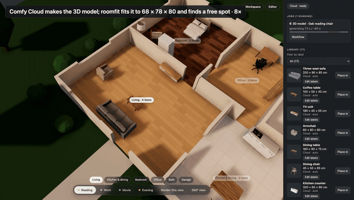
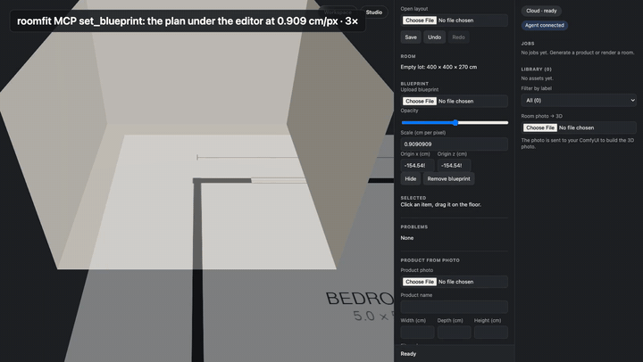
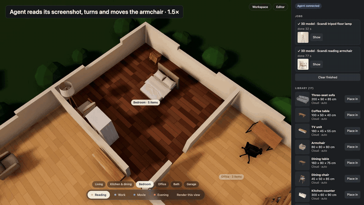
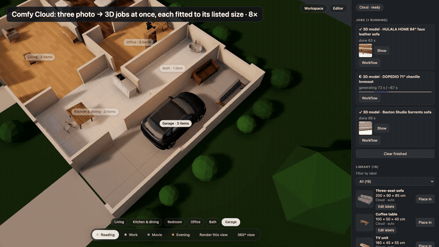
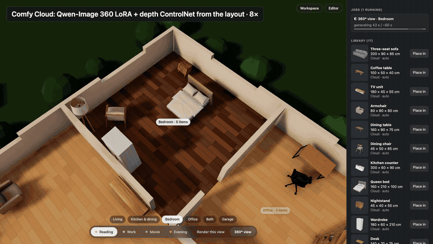
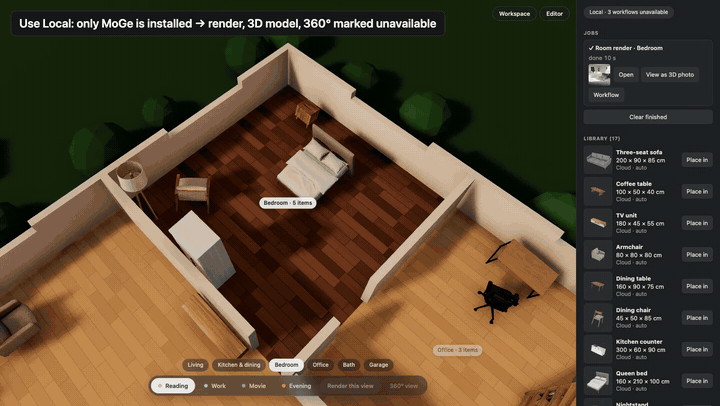
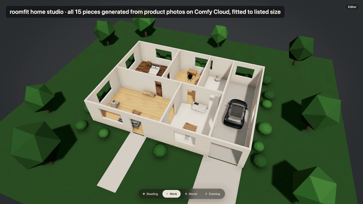

# ComfySims

*ComfyUI + a Sims-style home builder. Formerly **roomfit** — code identifiers (`window.roomfit`, the `roomfit` MCP server, `roomfit:` workflow tags, `RoomfitFitMesh`) keep the old name for now ([ADR-0011](docs/adr/0011-rename-to-comfysims.md)).*

**Does this sofa fit my living room?** Drop in a product photo and its listed size. ComfySims turns it into a 3D model on ComfyUI or Comfy Cloud, fits it to the exact listed size, places it in your room or a whole house, checks it against walls and other furniture, and renders the room back to a photo.

<p align="center"><a href="docs/recordings/media/roomfit-reel.mp4"></a><br><sub>Click any animation for the full video · <a href="docs/recordings/media/roomfit-reel.mp4">7-minute demo reel</a></sub></p>

## See it

<table>
<tr>
<td width="50%" valign="top"><a href="docs/recordings/media/roomfit-place.mp4"></a><br><b>Make it, put it anywhere</b><br>A product photo and its listed size become an exact-size 3D piece; drag it into place, turn it, render the room.</td>
<td width="50%" valign="top"><a href="docs/recordings/media/roomfit-blueprint.mp4"></a><br><b>From a floor plan to a house on its land</b><br>An agent reads a floor-plan image, builds walls, doors, windows and rooms (0 cm off the drawing), lays out the lot and renders it from the air and the street.</td>
</tr>
<tr>
<td width="50%" valign="top"><a href="docs/recordings/media/roomfit-agent.mp4"></a><br><b>An agent furnishes a room</b><br>One sentence to Claude Code with the Comfy Cloud MCP and the ComfySims MCP: product photos, 3D, placement, a self-check screenshot, a render.</td>
<td width="50%" valign="top"><a href="docs/recordings/media/roomfit-products.mp4"></a><br><b>Shop from real listings</b><br>Every piece keeps its photo, store link, brand and labels: compare candidates at their listed sizes, place one, jump to its product page. (Amazon example; photos belong to their sellers.)</td>
</tr>
<tr>
<td width="50%" valign="top"><a href="docs/recordings/media/roomfit-360.mp4"></a><br><b>360° view of your layout</b><br>A photoreal look-around generated from a depth panorama of your layout, so the furniture stays where you put it. Opt-in, one click.</td>
<td width="50%" valign="top"><a href="docs/recordings/media/roomfit-local-cloud.mp4"></a><br><b>Local or Cloud, per job</b><br>Render on Comfy Cloud, 3D photo on the ComfyUI on your Mac. ComfySims checks what each backend can run and names the missing model files.</td>
</tr>
<tr>
<td width="50%" valign="top"><a href="docs/recordings/media/roomfit-studio.mp4"></a><br><b>Home studio</b><br>A cut-away house with real materials, landscape and light presets; all 15 pieces generated from product photos on Comfy Cloud.</td>
<td width="50%" valign="top"><b>More</b><br>• <a href="docs/recordings/media/roomfit-reel.mp4">Full demo reel (7 min)</a><br>• <a href="docs/recordings/media/roomfit-cloud-live.mp4">Live Comfy Cloud run, 90 s</a><br>• <a href="docs/recordings/">Every implementation session, recorded</a><br>• <a href="docs/lecture/README.md">How it was built (lecture notes, Korean)</a></td>
</tr>
</table>

## What it does

| | |
| --- | --- |
| Real size | Generated meshes come out at arbitrary scale and turned to the photo's angle. ComfySims turns them to their smallest footprint and fits them to the listed width × depth × height (`exact`, `uniform` or `auto`), with a distortion report. |
| Real rooms | Box rooms or floor plans with walls, doors, windows and zones. Collisions and wall checks always use the listed size, never the mesh. |
| ComfyUI both ways | 2D → 3D (product photo to model) and 3D → 2D (depth, normal and mask passes into a ComfyUI render). Local ComfyUI or Comfy Cloud through the same client; your API key stays on the local server. |
| Node pack | `RoomfitFitMesh` fits any ComfyUI `MESH`, and the pack serves the editor at `/roomfit/` on your ComfyUI. |

## Quick start

```bash
pnpm install
pnpm web:dev                      # editor on http://127.0.0.1:5179
```

Use either backend, or both: the chip at the top of the workspace rail switches between **Local** (`ROOMFIT_LOCAL_URL`, default `http://127.0.0.1:8188`) and **Cloud** (`ROOMFIT_CLOUD_URL`, default `https://cloud.comfy.org`). Each job stays on the backend it started on, and every job card shows the exact workflow it ran (Download JSON, Open in ComfyUI). The workflow per backend and job kind is in `workflows/sets.json`.

For Cloud, put your key in `.env.local` (git-ignored; it is only added by the local dev server, only to Cloud requests). To start on Cloud:

```bash
echo 'COMFY_CLOUD_API_KEY=…' > .env.local
ROOMFIT_COMFY_URL=https://cloud.comfy.org pnpm web:dev
```

For Local, install the models a workflow needs (the chip lists what is missing). For example the 3D photo needs only MoGe (662 MB) in `ComfyUI/models/geometry_estimation/` ([Comfy-Org/MoGe](https://huggingface.co/Comfy-Org/MoGe)). The product → 3D workflow on Local also uses the ComfySims node pack: link `nodes/roomfit` into `custom_nodes/`, run `pnpm web:build:nodepack`, and the editor is also served at `/roomfit/` inside ComfyUI.

The editor also runs as an MCP server for agents (`pnpm mcp`, see `.mcp.json`).

## How it is built

ComfySims is built spec-first by coding agents inside a harness, and the whole process is recorded:

- `spec/` — milestone specs; every acceptance criterion (AC) is owned by tests. `pnpm verify` maps test results back to the AC table.
- `harness/` — Claude Code hooks: agents cannot edit specs, tests, fixtures or the harness, and cannot stop until `pnpm verify` passes. Includes a fake Comfy Cloud and a real local ComfyUI boot.
- `docs/adr/` — every decision and what was rejected.
- `docs/recordings/` — each implementation session (prompt, time, cost, what the agent reported) and the demos.
- `docs/journal/` — the build diary (Korean).

## Contributing

See [CONTRIBUTING.md](CONTRIBUTING.md): spec-first, `pnpm verify` as the judge, and how agent sessions fit in. The harness is described in [docs/harness.md](docs/harness.md).

## License

GPL-3.0, same as ComfyUI. See [LICENSE](LICENSE).
