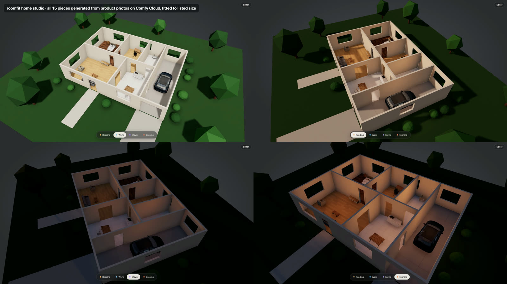

# roomfit

**Does this sofa fit my living room?** Drop in a product photo and its listed size. roomfit turns it into a 3D model on ComfyUI or Comfy Cloud, fits it to the exact listed size, places it in your room or a whole house, checks it against walls and other furniture, and renders the room back to a photo.



- **Home studio** — a cut-away 3D house with real materials, landscape and Reading / Work / Movie / Evening light presets. All 15 pieces in the demo were generated from product photos on Comfy Cloud. [video](docs/recordings/media/roomfit-studio.mp4)
- **Live Comfy Cloud run** — photo → 3D → fitted → placed → rendered, from the editor, in 90 seconds. [video](docs/recordings/media/roomfit-cloud-live.mp4)
- **Local or Cloud, per job** — switch between your own ComfyUI and Comfy Cloud from the workspace rail, no restart. roomfit checks what each one can run (node classes, and installed model files on Local) and greys out the rest with the missing files named. Here the render runs on Cloud and the 3D photo on a Mac's local ComfyUI with only MoGe installed. [video](docs/recordings/media/roomfit-local-cloud.mp4)
- **An agent furnishes a room** — one sentence to Claude Code with the Comfy Cloud MCP and the roomfit MCP: product photos, 3D, placement, a self-check screenshot, a render. [video](docs/recordings/media/roomfit-agent.mp4)
- **Shop from real listings** — every piece keeps its product photo, store link, brand and labels; compare candidates at their listed sizes, filter by label, and jump from the sofa in your house straight to its product page. Example with three Amazon sofas (product photos belong to their sellers). [video](docs/recordings/media/roomfit-products.mp4)
- **360° view** — a photoreal look-around of a room, generated from a depth panorama of your layout so the furniture stays where you put it. Opt-in, one click. [video](docs/recordings/media/roomfit-360.mp4)

## What it does

| | |
| --- | --- |
| Real size | Generated meshes come out at arbitrary scale and turned to the photo's angle. roomfit turns them to their smallest footprint and fits them to the listed width × depth × height (`exact`, `uniform` or `auto`), with a distortion report. |
| Real rooms | Box rooms or floor plans with walls, doors, windows and zones. Collisions and wall checks always use the listed size, never the mesh. |
| ComfyUI both ways | 2D → 3D (product photo to model) and 3D → 2D (depth, normal and mask passes into a ComfyUI render). Local ComfyUI or Comfy Cloud through the same client; your API key stays on the local server. |
| Node pack | `RoomfitFitMesh` fits any ComfyUI `MESH`, and the pack serves the editor at `/roomfit/` on your ComfyUI. |

## Quick start

```bash
pnpm install
pnpm web:dev                      # editor on http://127.0.0.1:5179
```

Use either backend, or both: the chip at the top of the workspace rail switches between **Local** (`ROOMFIT_LOCAL_URL`, default `http://127.0.0.1:8188`) and **Cloud** (`ROOMFIT_CLOUD_URL`, default `https://cloud.comfy.org`). Each job stays on the backend it started on, and every job card shows the exact workflow it ran (Download JSON, Open in ComfyUI). The workflow per backend and job kind is in `workflows/sets.json`.

For Cloud, put your key in `.env.local` (git-ignored; it is only added by the local dev server, only to Cloud requests). To start on Cloud:

```bash
echo 'COMFY_CLOUD_API_KEY=…' > .env.local
ROOMFIT_COMFY_URL=https://cloud.comfy.org pnpm web:dev
```

For Local, install the models a workflow needs (the chip lists what is missing). For example the 3D photo needs only MoGe (662 MB) in `ComfyUI/models/geometry_estimation/` ([Comfy-Org/MoGe](https://huggingface.co/Comfy-Org/MoGe)). The product → 3D workflow on Local also uses the roomfit node pack: link `nodes/roomfit` into `custom_nodes/`, run `pnpm web:build:nodepack`, and the editor is also served at `/roomfit/` inside ComfyUI.

The editor also runs as an MCP server for agents (`pnpm mcp`, see `.mcp.json`).

## How it is built

roomfit is built spec-first by coding agents inside a harness, and the whole process is recorded:

- `spec/` — milestone specs; every acceptance criterion (AC) is owned by tests. `pnpm verify` maps test results back to the AC table.
- `harness/` — Claude Code hooks: agents cannot edit specs, tests, fixtures or the harness, and cannot stop until `pnpm verify` passes. Includes a fake Comfy Cloud and a real local ComfyUI boot.
- `docs/adr/` — every decision and what was rejected.
- `docs/recordings/` — each implementation session (prompt, time, cost, what the agent reported) and the demos.
- `docs/journal/` — the build diary (Korean).

## License

GPL-3.0, same as ComfyUI. See [LICENSE](LICENSE).
