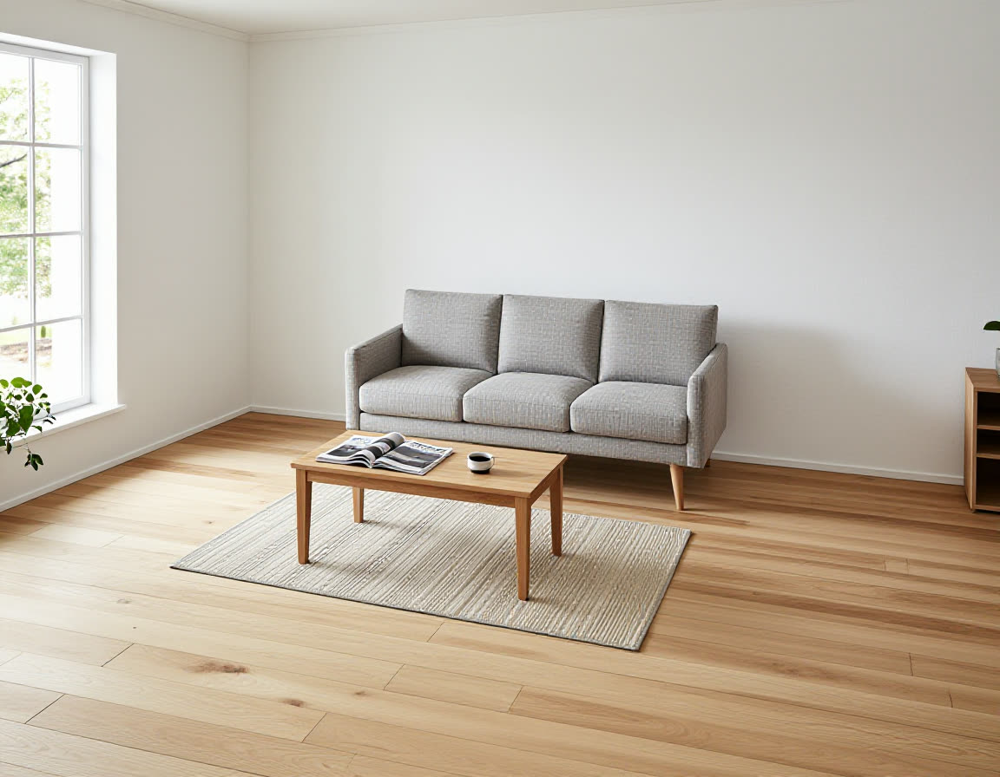

# roomfit

> Does this sofa fit my living room? Product photo + listed size → exact-size 3D model → placed in your room → photoreal render. Powered by ComfyUI.

Status: M1 working end to end (2026-10-18): 20 automated acceptance criteria pass; the end-to-end demo is recorded.

https://github.com/dante01yoon/roomfit/raw/main/docs/recordings/media/roomfit-demo.mp4



```bash
pnpm install
pnpm verify      # gates + acceptance-criteria status
```

- What we are building and when it is done: [spec/M1-scaled-furniture.md](spec/M1-scaled-furniture.md)
- How we work (spec-driven, harness-first): [spec/README.md](spec/README.md), [docs/harness.md](docs/harness.md)
- Why: [docs/adr/](docs/adr/) · Session journal: [docs/journal/](docs/journal/)
