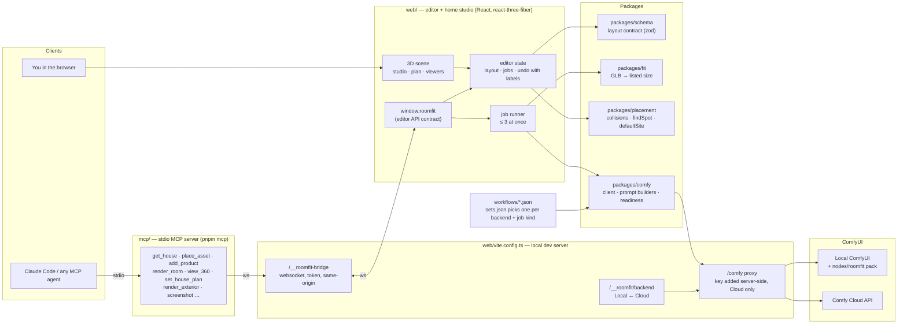
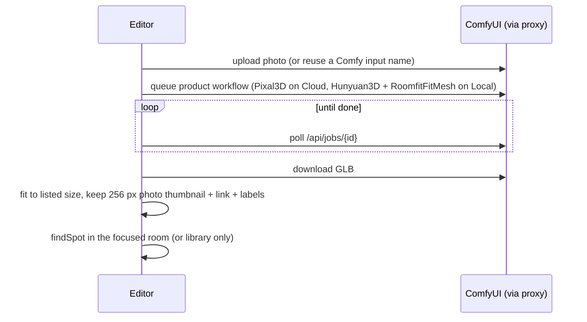
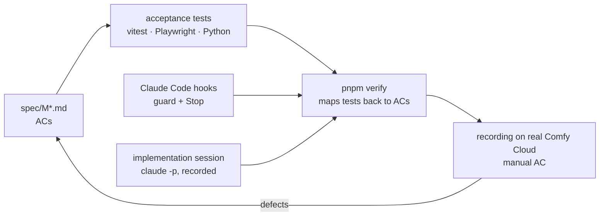

# Architecture

ComfySims is a browser editor that owns the house and the measurements, and ComfyUI (your own, or Comfy Cloud) that owns the generation. Everything between them is plain data: a layout file, API-format workflows, images and GLBs.

## The pieces

| Part | Owns | Key idea |
| --- | --- | --- |
| `packages/schema` | the layout file: room (box or plan: walls, openings, zones), assets (with product link, labels), placed items, site (lot, ground, trees), blueprint underlay | One zod schema; `spec/contracts/room-layout.schema.json` is generated from it and checked for drift. Centimetres everywhere; GLBs (metres) are converted only at the boundary. |
| `packages/fit` | turning a generated mesh into the listed size | Turns the mesh to its smallest footprint (photos are often 3/4 views), then fits `exact`, `uniform` or `auto` and reports distortion; > 1.15 is flagged. |
| `packages/placement` | where things can go | Collisions and wall checks use the listed size, never the mesh; `findSpot` puts a new piece against a free wall of a room; `defaultSite` lays out a lot around the house. |
| `packages/comfy` | talking to ComfyUI | Upload → queue → poll `/api/jobs` → download; prompt builders fill workflows by their `roomfit:*` tags; `missingFromCatalog` decides what a backend can run (node classes everywhere, installed model files on Local). |
| `web/` editor | the house you see and edit | A store with undoable edits (each labelled `editor` or `mcp:<tool>`), a react-three-fiber scene (plan view, cut-away studio, 3D-photo and 360° viewers), the jobs panel, the library, and `window.roomfit` — the contract the tests and the MCP bridge drive. |
| dev server plugins | everything secret or local | The Comfy proxy adds `COMFY_CLOUD_API_KEY` only to Cloud requests (the browser never sees it); the backend switch; the MCP bridge (127.0.0.1, token file, same origin). |
| `mcp/` | agents | A stdio MCP server whose tools forward to the open editor over the bridge, so an agent's edits appear live and are undoable. Images come back as MCP image content. |
| `nodes/roomfit` | the ComfyUI side | `RoomfitFitMesh` fits any ComfyUI `MESH` to a size; the pack also serves the editor at `/roomfit/` inside ComfyUI. |
| `workflows/` | the generation recipes | API-format JSON, linted against pinned node catalogs of local ComfyUI and Comfy Cloud. `sets.json` maps backend × job kind → file. |

## How a job flows

**Product photo → furniture in the house**

**Room → photo** — the editor renders depth, normal and mask passes from an eye-level camera (aimed at the selected item if any), uploads the depth, and queues `render-from-depth` (Z-Image Turbo + Fun ControlNet). The layout fixes the geometry; the model paints materials and light.

**360° view** — a 2048 × 1024 equirectangular depth panorama from the room's standing point → Qwen-Image 2512 + 360 LoRA + depth ControlNet → a sphere viewer.

**Floor plan → house → exterior** — an agent reads the plan image, calls `set_blueprint` (the image under the plan view) and `set_house_plan` (validated walls, openings, rooms; furniture outside new rooms goes back to the library), `set_site`, then `render_exterior`: a roof slab is added, trees are left out of the depth, the aerial camera frames the house at 30°, the street camera stands diagonal to the front door, and the depth range ends at the lot.

## How it is built and checked

Specs and tests are written in a spec session; implementation sessions cannot edit them (a hook blocks it) and cannot finish until `pnpm verify` passes. Tests use two fake ComfyUIs and catalogs captured from real ones; every milestone ends with a recording on real Comfy Cloud, which has found most of the defects. Details: [docs/harness.md](harness.md), [CONTRIBUTING.md](../CONTRIBUTING.md).

## Where to start reading

- The editor contract: `spec/contracts/editor-api.ts`
- The layout contract: `packages/schema/src/layout.ts`
- The MCP tools: `spec/contracts/mcp-tools.json`, `mcp/server.ts`
- One job end to end: `addProductFromPhoto` in `web/src/editor.ts`
- Decisions: `docs/adr/`
