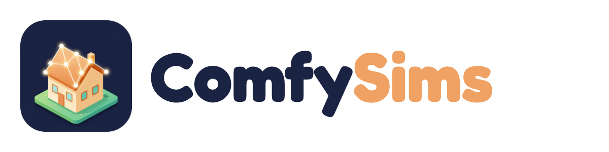

# ComfySims brand

A small house on a patch of lawn whose roof is drawn by glowing node-graph wires: a home you build (the Sims part) out of a graph (the ComfyUI part).

## Files

| File | Use |
| --- | --- |
| `icon-1024.png` … `icon-32.png` | app icon, rounded square with transparent corners |
| `wordmark-dark.png` / `wordmark-light.png` | icon + name, for dark / light backgrounds (transparent) |
| `banner.png` (1280 × 320) | top of the README |
| `social-preview.png` (1280 × 640) | GitHub → Settings → Social preview, link cards on X |
| `web/public/favicon.png` | the editor's tab icon |

## Colours (sampled from the icon)

| Name | Hex | Where |
| --- | --- | --- |
| Night navy | `#1b2343` | icon background, banners |
| Deep navy | `#121830` | gradient edge |
| Roof amber | `#efa263` | "Sims", accents |
| Wall cream | `#fce7c3` | "Comfy" on dark, text on dark |
| Lawn green | `#71bf6f` | ground, success |
| Wire mint | `#8fe3d2` | links on dark |

Type: **Fredoka** 700 for the name, **Inter** for text (both Google Fonts, OFL).

## How the icon was made

With ComfyUI itself: Z-Image Turbo text-to-image on Comfy Cloud (the `render-from-depth` workflow without its ControlNet), 1024 × 1024, 8 steps, seed 3, job `93fe953b-36c5-4c2b-a997-e90a9b9f8f26`, picked from six candidates (`demo/brand-icons.ts`). Prompt: *App icon for a home design app: a cute isometric miniature house whose roof outline is drawn by glowing node-graph wires linking small rounded nodes, sitting on a small square of green lawn. Flat vector illustration, soft gradients, warm amber and mint teal accents on a deep navy rounded-square background, centered, minimal, high contrast.* The negative prompt kept out text and gem or diamond shapes, so the mark does not borrow the Sims "plumbob". Wordmark, banner and preview are composed in HTML (`demo/brand-compose.mjs`).

## Not affiliated

ComfySims is an independent open-source project. It is not an official Comfy Org product, and it is not affiliated with or endorsed by Electronic Arts; "The Sims" is a trademark of Electronic Arts Inc. ComfyUI is used as the generation engine.
