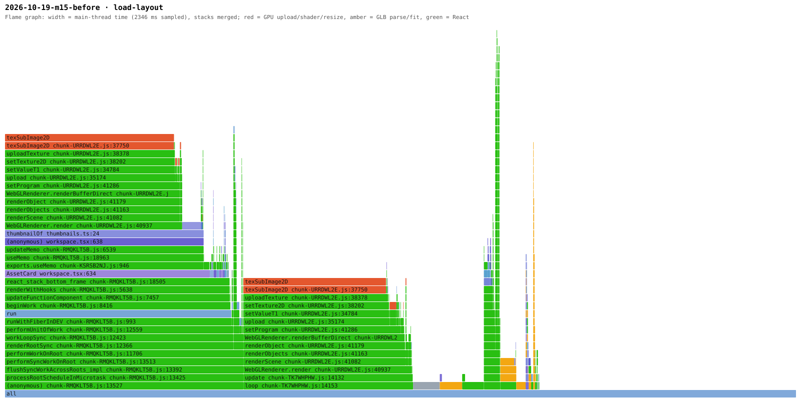
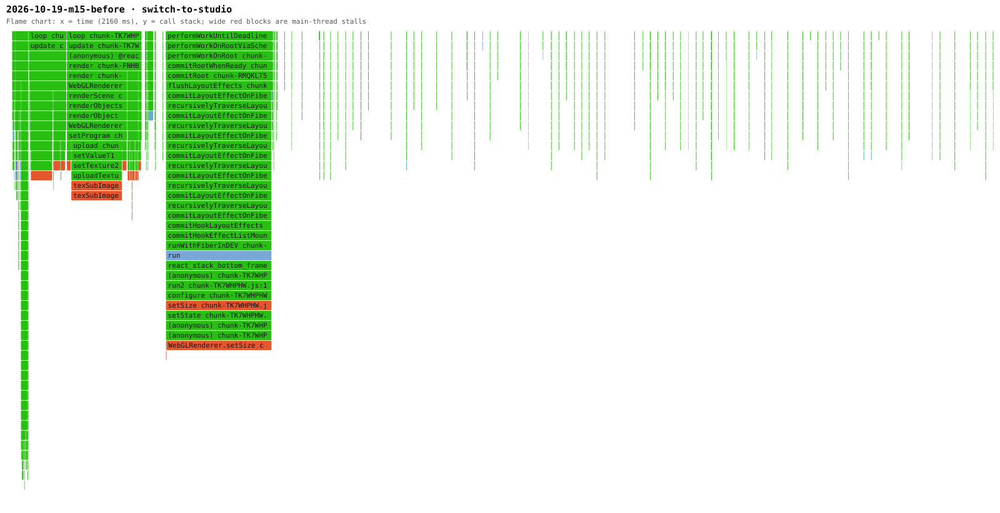
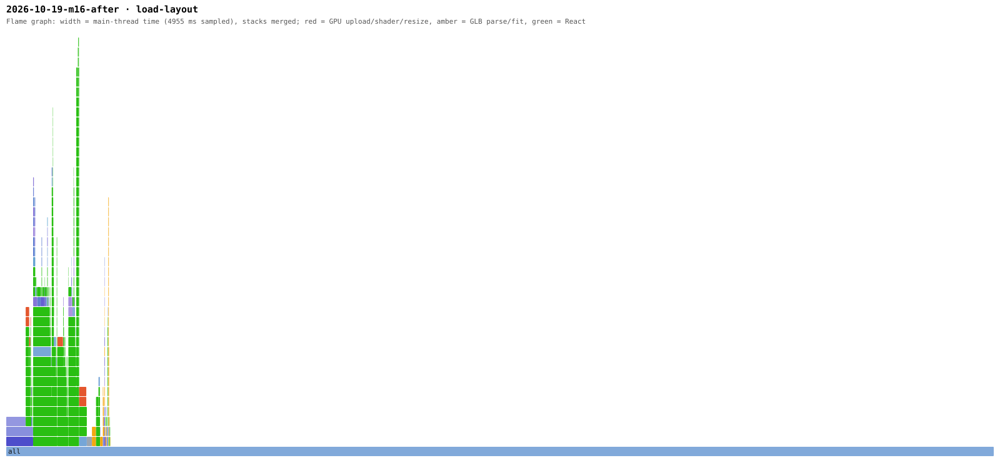

# Case study: making a generated-furniture house feel smooth

Status: in progress (started 2026-10-19). This file is written as the work happens: measurements first, then decisions, then results.

## The complaint

Dante, 2026-10-19, after watching two smooth Three.js interior demos (img2interior, a Blender-baked room, and an 8-million-splat capture of a real living room): "지금 되게 버벅이고 방 안도 못돌아다니고 하잖아" — the editor stutters, and you cannot move around inside a room.

## Step 1 — measure before guessing

Tool: [`demo/measure-motion.mjs`](../../demo/measure-motion.mjs). It opens the editor in a real GPU browser (Chromium, Metal), loads the 17-piece demo house (every piece generated on Comfy Cloud), and records per-frame timestamps, long tasks (> 50 ms), the camera position every frame, and a V8 CPU profile per scenario.

Machine: Apple M4 Max, 1600 × 900 viewport at device pixel ratio 2. This is a fast GPU; an ordinary laptop is slower, so these numbers are a best case.

| Scenario | fps | p95 frame | frames > 33 ms | long tasks | longest | largest camera step in one frame |
| --- | --- | --- | --- | --- | --- | --- |
| load the house | 13.9 | 211 ms | 21 | 6 | 148 ms | — |
| switch editor → studio | 45.2 | 17.7 ms | 4 | 2 | 243 ms | 16.9 m |
| idle (whole house) | 59.9 | 17.6 ms | 1 | 0 | — | 0 |
| orbit drag | 57.2 | 17.6 ms | 3 | 0 | — | 0.3 m |
| focus a room | 58.7 | 17.5 ms | 1 | 0 | — | **17.5 m** |
| wheel zoom | 59.3 | 17.5 ms | 0 | 0 | — | 0.5 m |

Raw data: [`data/m15-before-dpr2.json`](data/m15-before-dpr2.json) (and `m15-before-dpr1.json`).

### What the numbers say

1. **Steady-state frame rate is not the problem.** Orbiting and idling hold 60 fps.
2. **The stutter is hitches and teleports.**
   - Loading the house drops to 14 fps with six main-thread stalls of up to 148 ms.
   - Switching to the studio freezes for 243 ms.
   - Focusing a room moves the camera 17.5 m in a single frame. There is no transition; the camera teleports.
3. **The controls have no inertia.** The camera stops dead when the mouse stops, and the wheel zooms in fixed jumps. The reference demos glide.
4. **There is no way to walk.** The only cameras are an orbit around the house and an eye-level render camera.

## Step 2 — find the causes (CPU profiles)

Self time during **load** (2.4 s window):

| Function | ms | Meaning |
| --- | --- | --- |
| `texSubImage2D` | 922 | uploading textures to the GPU, synchronously, on the main thread |
| `createObjectURL` | 154 | wrapping fitted GLB bytes as blob URLs |
| GLTFLoader parsing | ~180 | parsing 17 large GLBs |
| `toDataURL` | 72 | thumbnails |
| `getProgramInfoLog` | 26 | synchronous shader compile checks |

Self time during **editor → studio**:

| Function | ms | Meaning |
| --- | --- | --- |
| `WebGLRenderer.setSize` | 139 | the canvas changes size between views, so every render target (shadow map, AO buffers) is reallocated |
| `texSubImage2D` | 136 | more texture uploads |
| `getProgramInfoLog` | 80 | the studio's shaders (shadows, N8AO, tone mapping) compile on first use |

### Flame graphs

Loading the house (before M15). Red is GPU texture upload.

The left red tower sits under `AssetCard → thumbnailOf → WebGLRenderer.render`: the library renders every asset's 3D thumbnail inside React's render. The right one is the scene's own render. The self-time table only said `texSubImage2D`; the flame graph showed *who* was calling it.

Switching to the studio (before M15), as a flame chart over time. The wide red block is `WebGLRenderer.setSize`, called from a React layout effect: the canvas changes size between views.

How the measurements were taken, and how each improvement point was traced from a number to a line of code: [perf/METHOD.md](perf/METHOD.md).

### Root cause: the generated assets are far heavier than a room needs

Every piece from the image-to-3D workflow comes out the same way:

| Asset | File | Triangles | Textures |
| --- | --- | --- | --- |
| armchair | 17.0 MB | 119,426 | 3 × 2048² PNG |
| sofa | 14.2 MB | 119,852 | 3 × 2048² PNG |
| car | 17.4 MB | 118,070 | 3 × 2048² PNG |
| … (15 total) | 205 MB | ~1.8 M | 45 × 2048² PNG |

- Three 2048² RGBA textures with mipmaps take about 48 MB of GPU memory per piece. That is about 800 MB for one furnished house, and every byte is uploaded on the main thread.
- A 70 cm armchair seen across a room covers a few hundred pixels on screen. It needs neither 120,000 triangles nor 2048² textures.
- Fitting already rewrites every GLB (`packages/fit`), so the cheapest place to fix the assets is that same step.

## Step 3 — plan

Two milestones, so each one has its own before/after:

- **M15 — Smooth camera and walk mode.**
  - Damped controls.
  - Eased transitions for every camera change: focus, view switch, render view.
  - A first-person walk mode inside rooms that stops at walls and passes through doors.
  - Render on demand.
- **M16 — Light assets, no hitches.**
  - At fit time, simplify meshes and shrink and compress textures.
  - Do the fitting and optimising in a Web Worker.
  - Cache the result.
  - Upload textures progressively.
  - Precompile shaders.
  - Keep the canvas size stable across views.

Targets (to be checked with the same script):

| Metric | Before | Target |
| --- | --- | --- |
| Load: longest main-thread stall | 148 ms | < 50 ms |
| Load: p95 frame | 211 ms | ≤ 33 ms |
| View switch: longest stall | 243 ms | < 50 ms |
| Focus: largest camera step per frame | 17.5 m | ≤ 0.5 m, transition 0.6–1 s |
| GPU texture memory per piece | ~48 MB | ≤ 6 MB |
| GLB size per piece | 7–17 MB | ≤ 2 MB |
| Walk inside a room | not possible | WASD + drag-look at 160 cm eye height; walls stop you, doors let you through |

## Step 4 — M15 results (before vs after, same machine, same conditions)

Method:
- Each version runs from its own checkout: before = `0761e71`, after = `f9a187c`.
- Headless Chromium on the real GPU (ANGLE Metal, M4 Max) at DPR 2.
- Median of 3 runs, each in a fresh browser.
- Every run's numbers, plus the first run's CPU profiles and Chrome traces, are in [`perf/`](perf/README.md).
- Headless also fixes the frame clock at 60 Hz. Headful runs had drifted between 60 and 120 Hz depending on which display the window opened on.

| Scenario | Metric | Before | After |
| --- | --- | --- | --- |
| Focus a room | largest camera step in one frame | 1,731 cm (teleport) | 85 cm (4.9% of a 17.3 m glide) |
| Switch editor → studio | largest camera step | 1,688 cm | 347 cm (a 131 ms stall lands mid-glide) |
| Switch editor → studio | longest stall | 223 ms | 131 ms |
| Idle 3 s (whole house / room) | frames rendered | ~180 (60 fps, always) | **0** |
| Orbit drag | frames rendered | always | only while moving (303), then coasts to rest |
| Walk to the kitchen | — | not possible | works: 140 cm/s, through the door, no stalls |
| Load the house | longest stall (median) | 156 ms | 105 ms (unchanged cause: textures, M16) |

### What profiling caught that the tests did not

The after-run showed `wheel-zoom` with **0 camera movement and 0 rendered frames**.

- **Reproduced:** headless, with a probe script.
- **Narrowed down:** zoom worked over the whole house, but not after focusing a room.
- **Cause:** `document.elementFromPoint` at the canvas centre returned the room-label **button**. A focused room's label sits exactly at the screen centre. The new wheel handler listened on the `<canvas>` only, while drei's OrbitControls had listened on the wrapper.
- **Fix process:** a regression test (AC-124) was written red first, then fixed in a recorded session.

### An honest miss in the spec

AC-123 originally asked for "≤ 50 cm per frame" when focusing. That was mis-specified.

- A 17 m move that lasts ≤ 1 s with ease-in-out peaks near 1.5–2× its average speed, so ~60–90 cm per frame. Meeting an absolute limit would make long moves sluggish.
- The criterion is now relative (≤ 6% of the glide per frame, no frame gap > 33 ms).
- The spec's change log records that the original target was not met.

### Bundle (after M15)

One chunk of 1,590 KB (489 KB gzip):

| Package | Size |
| --- | --- |
| three | 729 KB |
| react-dom | 178 KB |
| n8ao | 137 KB |
| app code | 129 KB |
| react-reconciler | 110 KB |

Code-splitting the viewers and post-processing is on the M16 list.

## Step 5 — M16 results (before vs after, same method)

Before = `c4f6d24` (M15 done, M16 spec only), after = `6879ae4`. Headless real GPU, median of 3 fresh-browser runs. Reports: [m16-before](perf/2026-10-19-m16-before/report.md), [m16-after](perf/2026-10-19-m16-after/report.md).

| Scenario | Metric | Before | After |
| --- | --- | --- | --- |
| First load (cold) | frames per second while loading | 18.6 | **57.6** |
| First load (cold) | p95 frame gap | 150 ms | **16.8 ms** |
| First load (cold) | main-thread stalls / longest | 7 / 143 ms | **1 / 66 ms** |
| First load (cold) | wall time until every piece is in | 1.9 s | 5.3 s (slower, see below) |
| Reload (cached) | stalls / longest | 11 / 130 ms | **0 / 0 ms** |
| Reload (cached) | wall time | 2.5 s | **0.8 s** |
| Switch to studio | longest stall | 167 ms | 69 ms |
| Switch again after reload | longest stall | 86 ms | 76 ms |
| GPU texture memory, whole house | — | ~1,090 MB (estimated: 45 × 2048² RGBA + mips) | **209 MB** (measured, `renderStats`) |
| Triangles drawn, whole house in the studio | — | ~2.0 M | **0.81 M** |
| `texSubImage2D` main-thread time during load | — | ~920 ms | **39 ms** |

### Reading it honestly

- **The freeze on load is gone; the cold load got slower.** One worker optimises 17 pieces (205 MB) one after another: simplify plus WebP encoding.
  - The main thread stays at ~58 fps and pieces appear as they finish, with box stand-ins first. But the house is complete at 5.3 s instead of 1.9 s.
  - Every later load comes from the cache in 0.8 s.
  - A worker pool (one per 2 cores) is the obvious next step.
- **AC-131 is only partly met.**
  - Met: cached load has no stall over 50 ms (0 ms), and the cold load has none over 100 ms (66 ms).
  - Not met: the view switch still stalls 69–76 ms against a 50 ms target. The profile names the cause: `getProgramInfoLog`, 34–54 ms of self time. three.js checks every new shader program synchronously (`renderer.debug.checkShaderErrors`, on by default), and the studio precompile only starts after 2 s of idle, so a switch right after load still compiles. Two fixes: turn the check off in production, and precompile as soon as the house is loaded.
- **Texture memory per piece is 12.3 MB, not the 6 MB I set as a goal in Step 3.** The spec (AC-130: ≤ 25% of unoptimised) is met at 19%. The 6 MB goal would need 512² for everything or GPU-compressed KTX2 textures (ADR-0014's next step).
- **The measurements run on the Vite dev server.** React development mode (`jsxDEV`) shows up in every profile, so absolute numbers are pessimistic. The next run should also measure a production build.

The same load after M16: the main thread is idle most of the 5.3 s window while the worker optimises, and the red upload towers from Step 2 are gone.

## Log

- 2026-10-19 — Baseline measured; causes found from CPU profiles and GLB inspection; plan written.
- 2026-10-19 — M15 spec written with 7 automated acceptance criteria (AC-116~122) and one real-GPU measurement (AC-123).
  - Key design decision ([ADR-0013](../adr/0013-camera-transitions-keep-the-resting-pose-contract.md)): `camera()` stays the *resting pose* and only the on-screen camera animates. So 13 existing tests, every render path and the agent tools keep working unchanged.
  - Walk collision is plain 2D geometry against the listed-size footprints; no physics engine.
  - Implementation handed to a recorded headless session (impl-32).
- 2026-10-19 — impl-32 implemented M15. BLOCKED once: AC-118's drag started on the coffee table, so the test moved furniture instead of the camera (a test-design slip). It was fixed by starting the drag on empty ground and asserting nothing got selected. Verify then passed (CI-equivalent locally).
- 2026-10-19 — Measurement tooling upgraded:
  - Chrome traces, V8 CPU profiles, heap, GC and rendered-frame counts per scenario.
  - Median of 3 headless runs on the real GPU.
  - A bundle composition report.
  - A run index at `perf/README.md`.
- 2026-10-19 — Before/after measured. Profiling found the wheel-over-label regression; AC-124 added red; AC-123 made relative (see above). impl-33 fixes AC-124.
- 2026-10-19 — Final M15 measurement (`perf/2026-10-19-m15-final`):
  - Wheel zoom renders 154 frames with a largest step of 19 cm; the AC-124 fix works.
  - Focus peaks at 83 cm per frame, 4.8% of the glide, with 0 frame gaps over 33 ms. AC-123 is met.
- 2026-10-19 — Walk recording (`docs/recordings/media/roomfit-walk.mp4`, headless, muted). It caught one more defect no test covered: in walk mode the key hint wrapped one word per line inside the bottom bar, stretching the bar to ~220 px. AC-133 was added red; the fix goes into the M16 session.
- 2026-10-19 — M16 spec activated:
  - 7 ACs: optimiser unit tests on a synthetic heavy fixture (119,600 triangles, three 2048² textures), worker, cache, stable canvas, chunks, render stats, thumbnails.
  - Plus one real-GPU AC.
  - The fake ComfyUI can now return any fixture as the generated product (`/__product-glb`).
- 2026-10-19 — impl-34 implemented M16 (53 min, 231 turns). Every M16 target AC passed. It was BLOCKED on two spec-side slips:
  - A missing `optimised` field on the `FitReport` type.
  - A fixed-sleep MCP test that had only passed because of the old canvas resize.

  Both fixed. Honest note: AC-129 (entry chunk ≤ 1,100 KB) was met by splitting vendors into separate chunks, which does not reduce the bytes loaded at startup. The criterion was mis-specified and the startup weight is a follow-up.
- 2026-10-19 — M16 measured before/after.
  - Cold load: freeze gone (18.6 → 57.6 fps, longest stall 143 → 66 ms) but slower to complete (1.9 → 5.3 s).
  - Cached reload: 0.8 s with no stalls.
  - GPU textures: ~1.09 GB → 209 MB.
  - AC-131 partly met: the view switch stalls 69–76 ms on synchronous shader checks (`getProgramInfoLog`).
  - Follow-ups: disable shader error checks in production, precompile right after load, a worker pool, measure production builds, KTX2.
- 2026-10-20 — First CI run with the M15/M16 tests (GitHub runner, software WebGL at ~3 fps with the demo house): 6 of 105 e2e failed. Fast-machine-only assumptions surfaced:
  - **Dev-server reload.** Vite discovered the worker's dependencies (gltf-transform, meshoptimizer) only when the first product was generated, and reloaded the page mid-test. Reproduced locally from a cold cache; fixed with `optimizeDeps.include` and confirmed by the reproduction script.
  - **Derived data vs undo.** Thumbnails written in the background landed in the layout, so "undo back to the loaded layout" no longer compared equal. The test now ignores derived thumbnails.
  - **Frame-rate-dependent settling.** Inertia counted as "moving" until the per-frame step fell below a fixed distance. At 3 fps each frame steps further, so the camera "moved" for 4.5 s after it looked still. Renders and screenshots wait on that flag. It is now judged by speed (impl-36).
  - **Glide sampling.** At 3 fps a 0.8 s glide shows only 2–3 frames. The motion tests now run at 800 × 450 so the software renderer keeps up.
