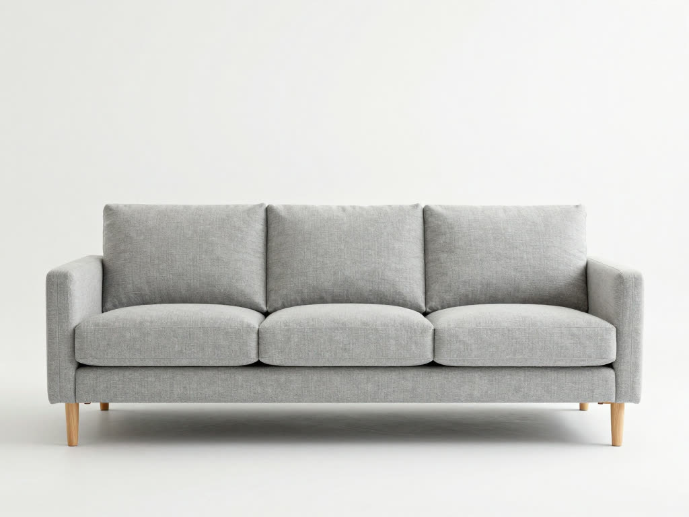
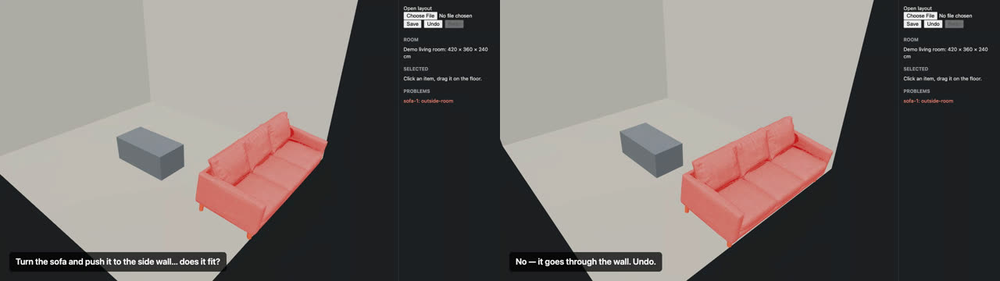
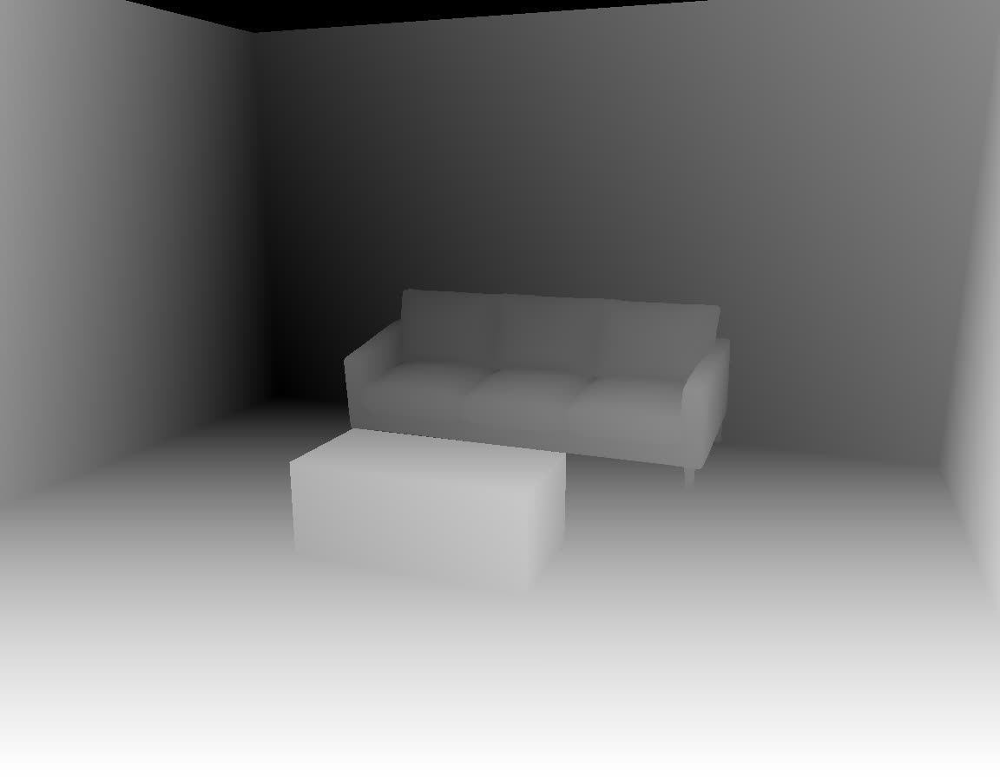

# AC-10 demo — product photo to photoreal room (2026-10-18)

Video: [media/roomfit-demo.mp4](media/roomfit-demo.mp4) (28 s). Run by the reviewer (spec session), not by an implementation agent.

| Step | Tool | Result |
| --- | --- | --- |
| 1. Product photo | Comfy Cloud, `image_z_image_turbo` template (open model, no API cost) | front-view sofa photo, 1024×768 |
| 2. Photo → 3D | Comfy Cloud, `3d_pixal3d_trellis2_image_to_model` template, decimated to 120k faces | textured GLB, **94.1 × 41.1 × 37.6 "cm"**, off-center |
| 3. Fit to listing | `fitGlb` (packages/fit) | `exact`: **200 × 85 × 90 cm**, distortion 1.157 → flagged; `uniform`: 194.5 × 85 × 77.8 cm |
| 4. Place | editor (`demo/record-demo.mjs`, Playwright video) | collision with the table and the side-wall check light up; undo restores |
| 5. Passes | `window.roomfit.exportPasses` at 1152×896 | depth / normal / mask PNG |
| 6. Render | Comfy Cloud, `workflows/render-from-depth.json` built with `buildRenderPrompt` | photoreal room matching the layout |






## What the demo changed

- **Front direction was wrong in the spec.** ADR-0002 said products face −Z; the real TRELLIS.2 output faces +Z (glTF convention). ADR corrected.
- **The first render workflow could not run on Cloud.** `controlnet-depth-sdxl-1.0.safetensors` is listed by Cloud's `ControlNetLoader` but fails prompt validation every time (two attempts, not billed). Switched `render-from-depth` to Z-Image Turbo + Fun Union ControlNet (the nodes Comfy's own template uses). The pinned catalog gained those nodes; model-file combos are no longer checked because local and Cloud installs differ.
- **The demo script had a bug, not the editor.** First recording pushed the turned sofa to x = 150, which fits; the editor correctly said "None". Fixed to x = 180.

## Reproduce

```bash
node demo/serve-assets.mjs &      # serves demo/out on :5180 with CORS
pnpm web:dev &                    # editor on :5179
node demo/record-demo.mjs         # needs demo/out/sofa-fitted-exact.glb
node demo/caption-cards.mjs
```

Cloud job ids: photo `f8ff0e3c-1800-4d69-9237-054601ede751`, 3D `4898b060-4829-4586-810d-73a52ed354e6`, render `3eb70127-a006-41ed-ad71-71da7c947d89`.
