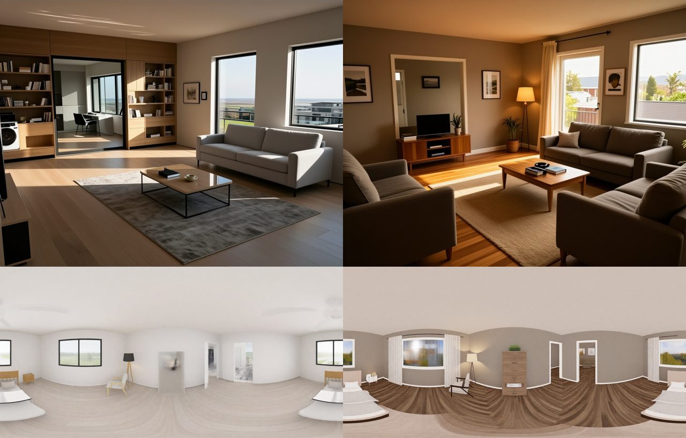

# AC-103 — as built vs lived-in, in the real app on Comfy Cloud (2026-10-19)

Real app (`demo/check-realism.mjs`), furnished demo house, evening preset, Comfy Cloud:

- **Top:** the living room, "Render this view" with Render style **As built** (left) and **Lived-in** (right). As built is tidy and showroom-like; lived-in has warm greige walls, a rug, lamps, prints and plants around the same sofa, armchair, coffee table and TV unit.
- **Bottom:** the bedroom 360° view before M13 (left, AC-69: white walls, the wardrobe a smudge) and with the lived-in prompt (right): walnut floor, curtains, warm walls, and the wardrobe drawn as a piece of furniture because the prompt names it.

Seen but not fixed: lived-in renders add things the layout does not have (a second sofa-like seat, a mirror where the kitchen opening is). Depth strength stays at 1.0; lowering it made this worse in the spike (`docs/spikes/m13/room-variants.jpg`).
