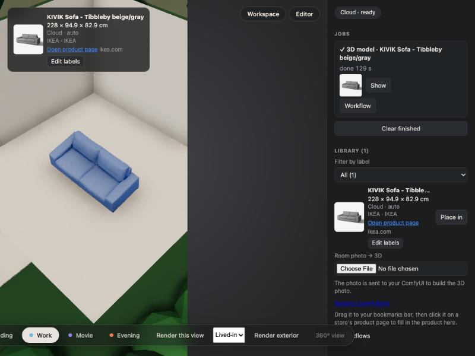

# AC-109 — a real store page → bookmarklet → Comfy Cloud → placed

Date: 2026-10-19 · Backend: Comfy Cloud (`ROOMFIT_COMFY_URL=https://cloud.comfy.org pnpm web:dev`)

## Steps

1. Editor open at `http://127.0.0.1:5179`; the bookmarklet code came from `window.roomfit.bookmarklet()` (7.3 KB, editor origin baked in).
2. Real page in the built-in browser: `https://www.ikea.com/us/en/p/kivik-sofa-tibbleby-beige-gray-s39440593/`.
3. Ran the bookmarklet on that page. It read the page's JSON-LD `Product` (and its `3DModel` entry) and opened the editor with `#import=…`.
   - Scripted runs are not user gestures, so `window.open` was replaced to capture the URL, and the tab was navigated to it. A click on the bookmark opens it directly.
4. Editor showed "Imported from IKEA — check the size" with the form filled; the photo was fetched through `/__roomfit/fetch-image`.
5. Clicked **Generate 3D**.

## Extracted

| Field | Value |
| --- | --- |
| name | KIVIK Sofa - Tibbleby beige/gray |
| brand / store | IKEA / IKEA |
| size (W×D×H) | 228 × 94.9 × 82.9 cm |
| image | the product's main photo (`…s5.jpg`) |
| 3D model on page | a Draco `.glb` URL (not used; store 3D import is a later milestone) |
| sources | `json-ld` |

## Result

```json
{ "status": "done", "seconds": 129.8,
  "asset": { "dims": { "width": 228, "depth": 94.9, "height": 82.9 },
             "url": "https://www.ikea.com/us/en/p/kivik-sofa-tibbleby-beige-gray-s39440593/",
             "brand": "IKEA", "store": "IKEA", "thumb": true,
             "fit": { "mode": "auto", "distortion": 1 } },
  "items": 1 }
```



The asset keeps its product link, brand, store and thumbnail; the fit is exact (distortion 1) and the sofa is placed in the room.

## Notes

- Amazon pages showed a bot check in the automated browser, so the run used IKEA. The Amazon path is covered by the AC-105 fixture test. The bot check was not bypassed.
- The page's Draco model is listed but not imported; its licence and format handling are a separate milestone.
