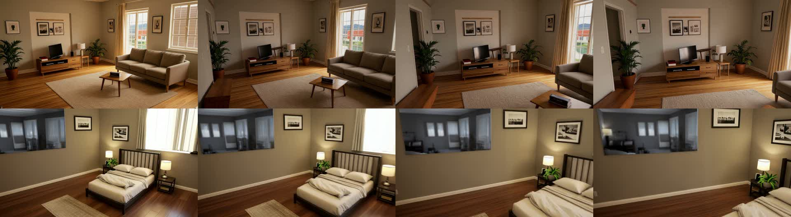

# AC-144: walkthroughs of the living room and the bedroom on real Comfy Cloud (2026-10-20)

**Video:** [media/roomfit-walkthrough.mp4](media/roomfit-walkthrough.mp4) (58 s). The Cloud waits play at 12×.

**Clips as downloaded:**
- [media/m17-walkthrough-living.mp4](media/m17-walkthrough-living.mp4)
- [media/m17-walkthrough-bedroom.mp4](media/m17-walkthrough-bedroom.mp4)

Both are 1280×704, 25 fps, 4.84 s, H.264.

**How it ran:**
- **Setup:** `pnpm web:dev` against `https://cloud.comfy.org`. The layout is the furnished demo house (`demo/out/house/furnished-layout.json`, 15 pieces generated on Comfy Cloud), with the Reading preset.
- **Recording:** `demo/record-walkthrough-video.mjs` in headless Google Chrome.
- **Actions:** a click on the room chip, then a click on "Walkthrough video", then Download. Nothing was stubbed.

| Room | path | first frame | uploads | queued | generating | done |
| --- | --- | --- | --- | --- | --- | --- |
| Living | 0 s | 3.7 s | 63.6 s | 65.6 s | 68.5 s | 132 s |
| Bedroom | 0 s | 3.2 s | 12.3 s | 14.4 s | 17.3 s | 70 s |

- **Time:** the first frame of the first job waited ~60 s for a Cloud worker, which is a cold start. The second walkthrough took 70 s in all.
- **Credits:** 0 (no paid API nodes).

Frames 0, 40, 80 and 120 of each clip:
- **Living:** the TV unit, both plants, the lamp, the window and the armchair stay where the layout has them while the camera dollies and pans.
- **Bedroom:** the bed, both nightstands and lamps, and the west window stay in place.

## Found by the recording (tests were green)

1. **Playwright's Chromium shows a black viewer.** The first take used Playwright's bundled Chromium, which has no H.264 decoder. The viewer stayed black at 0:00, while Download still worked. Real Chrome, Edge and Safari play the mp4.
   - Affected users: anyone on a browser without H.264 (some Linux Chromium and Firefox builds).
   - Candidates: show "This browser cannot play this video — Download it" when the `<video>` errors, or set `SaveVideo` to WebM/VP9.
   - Needs a spec item before fixing.
2. **Windows read as dark glass.** The bedroom's west window (sill 90 cm) is beyond the 900 cm depth range, so it is black in the control video. The model paints a dark, mirror-like pane rather than daylight outside.
   - The 360° view (M5) treats openings as far in the same way, but there the prompt carried more of the room.
   - Candidate: add "daylight through the windows" to the walkthrough prompt for day presets.
3. **The cold start dominates the first job.** 60 of the living room's 132 s went to the first-frame render waiting for a worker. Later jobs were near the spike's timing.

