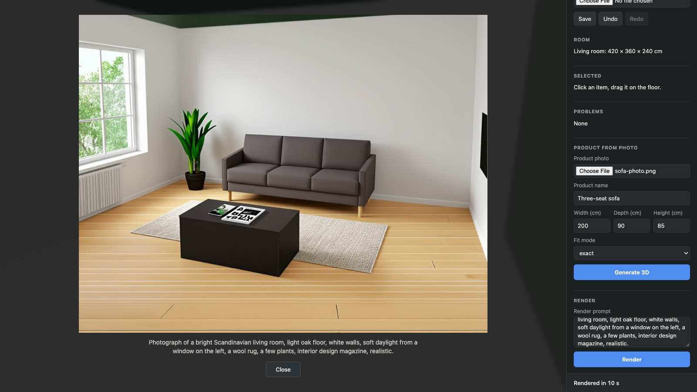

# AC-27 — the editor driving Comfy Cloud, recorded live (2026-10-18)

Video: [media/roomfit-cloud-live.mp4](media/roomfit-cloud-live.mp4) (36 s; the 62 s generation wait is shown at 8× and labelled).

Real run, no stubs: `pnpm web:dev` with `ROOMFIT_COMFY_URL=https://cloud.comfy.org` and the owner's key in `.env.local` (server-side proxy only). Recorded by `demo/record-cloud-demo.mjs` (Playwright, 1600×900), cut by `demo/badge.mjs` + ffmpeg.

| Mark | Time | What happened |
| --- | --- | --- |
| generate-click | 3.7 s | photo + 200 × 90 × 85 cm submitted through the side panel |
| placed | 67.7 s | Cloud generated the 3D model (Pixal3D), editor downloaded and fitted it: `exact`, distortion 1.13 (under the 1.15 flag) |
| render-click | 73.7 s | depth pass uploaded, `render-from-depth` queued |
| rendered | 86.6 s | Cloud render shown in the overlay ("Rendered in 10 s") |

Whole flow: 90 s wall clock. Asset saved as `comfy-output:roomfit/<hash>.glb`; job statuses uploading → queued → in_progress → downloading → fitting → done for both jobs.

