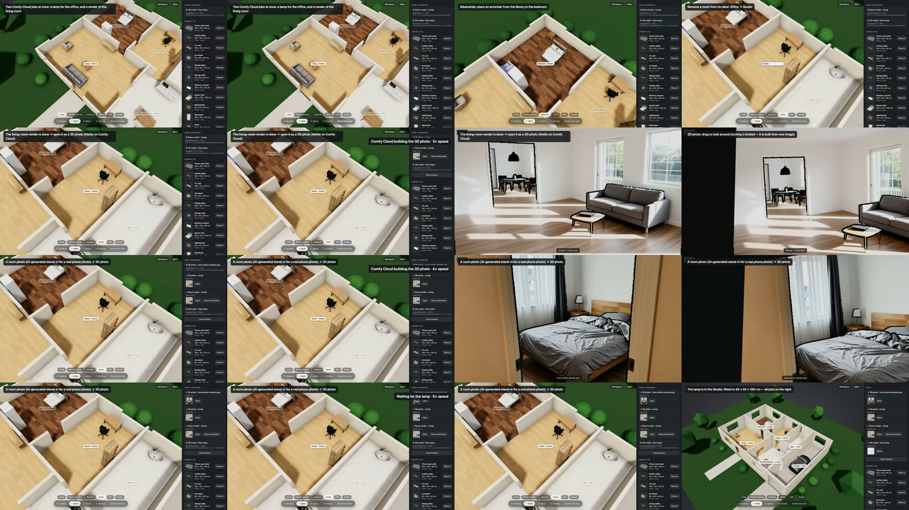

# AC-55 — M3 house workspace on real Comfy Cloud (2026-10-18)

Video: [media/roomfit-workspace.mp4](media/roomfit-workspace.mp4) (48 s; Cloud waits at 3–5× and labelled). Recorder: `demo/record-workspace.mjs` (Metal, 1600×900).

| Scene | Real time |
| --- | --- |
| Lamp product job and living-room render start together; two cards run side by side (AC-47/48) | — |
| Armchair placed from the library into the bedroom (AC-52); Office renamed to Studio from its label (AC-50/51) | — |
| Render → "View as 3D photo" (MoGe on Cloud), viewer fills the frame (AC-53, AC-62) | 10 s |
| Room photo → 3D photo (AI-generated stand-in, labelled in the video) | 17 s |
| Lamp finished in parallel and placed in the Studio | 70 s after start |

The previous take (same day) showed 3D photos as small cards in black → AC-62. The room photo is an AI-generated stand-in until Dante provides a real one.
