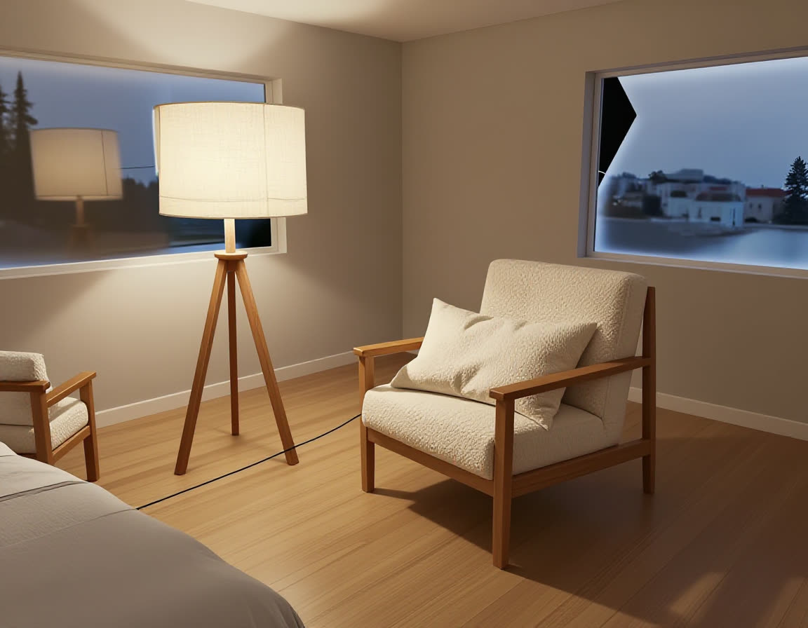

# AC-61 — an agent furnishes the bedroom from one sentence (2026-10-18)

Video: [media/roomfit-agent.mp4](media/roomfit-agent.mp4) (99 s; waits sped up and labelled). Prompt: [prompts/agent-01-reading-corner.txt](prompts/agent-01-reading-corner.txt).

Real run, no stubs, no human input after the prompt:

- `pnpm web:dev` against `https://cloud.comfy.org` (key only in the dev proxy), the furnished demo house open in the studio (`demo/record-agent.mjs`, Playwright 1600×900).
- `claude -p "<prompt>" --mcp-config .mcp.json --allowedTools mcp__roomfit mcp__comfy-cloud`, transcript in `.recordings/agent-01-reading-corner.jsonl` (local).
- Video cut by `demo/edit-agent.mjs`. Playwright's recording runs 1.13× longer than wall clock under load, so badges are placed on recording time (fitted on two scene cuts: bedroom zoom, render opening).

| Wall clock | What the agent did |
| --- | --- |
| 0:15 | `get_house` — editor shows "Agent connected" |
| 0:20 | Comfy Cloud MCP: `get_template_schema(image_z_image_turbo)`; `submit_batch` refused by the spend gate, so two single `run_template` calls (open model, no paid API nodes) |
| 1:28 | downloaded both photos and looked at them, then `add_product` ×2 with `{ path }`, listed sizes 68×78×80 and 50×50×155 cm, room "Bedroom" |
| 2:47 | armchair placed: `exact`, yaw alignment 56° |
| 3:19 | lamp placed: `exact`, yaw 22.5° |
| 3:21 | `focus_room(bedroom)`, `screenshot` → saw the chair facing the wall → `rotate_item 135°`, `move_item` ×2, `screenshot` after each |
| 3:44 | `render_room(bedroom, preset "reading", own prompt)` → 28 s on Cloud, image returned and saved to `.harness/renders/render-3.png` |
| 6:07 | final report |

Totals: 6 min 7 s, 29 turns, $1.34 agent cost (Cloud credits separate: 2 photos, 2 Pixal3D, 1 render).

## What the run showed (for the lecture)

1. **The agent used the screenshot to correct itself.** After the first screenshot it turned the chair 135° and moved it twice. This loop is why `screenshot` is an M4 tool.
2. **The Cloud spend gate shaped the plan.** `submit_batch` always asks for spend confirmation; the agent switched to single runs, which only ask when paid API nodes are involved.
3. **It chose `{ path }` over `{ comfyInputName }`.** It wanted to look at the photos first, so it downloaded them; the zero-upload path (AC-58) went unused. Seeing is worth an upload.
4. **My uncommitted edits made the agent's Stop hook run.** The Stop hook skips verify on a clean tree, but I was fixing the guard (item 5) in the same checkout during the run. So verify ran, e2e could not bind port 5179 (the editor the agent was driving), and the agent ended `BLOCKED:`. It refused to kill the editor ("the reading corner … lives there") and pointed out the two harness files it had not changed. Lesson: the spec session must not edit the checkout an agent is working in.
5. **The guard had a false positive.** A read-only `ls spec 2>/dev/null; sed -n … spec/M4…` was blocked because `>` in `2>/dev/null` counted as a write. Fixed in the guard with self-tests.
6. **Visible limits.** The render has a black artifact in the right window; the agent's `--allowedTools` did not stop Bash (the session's permission mode let it through).
