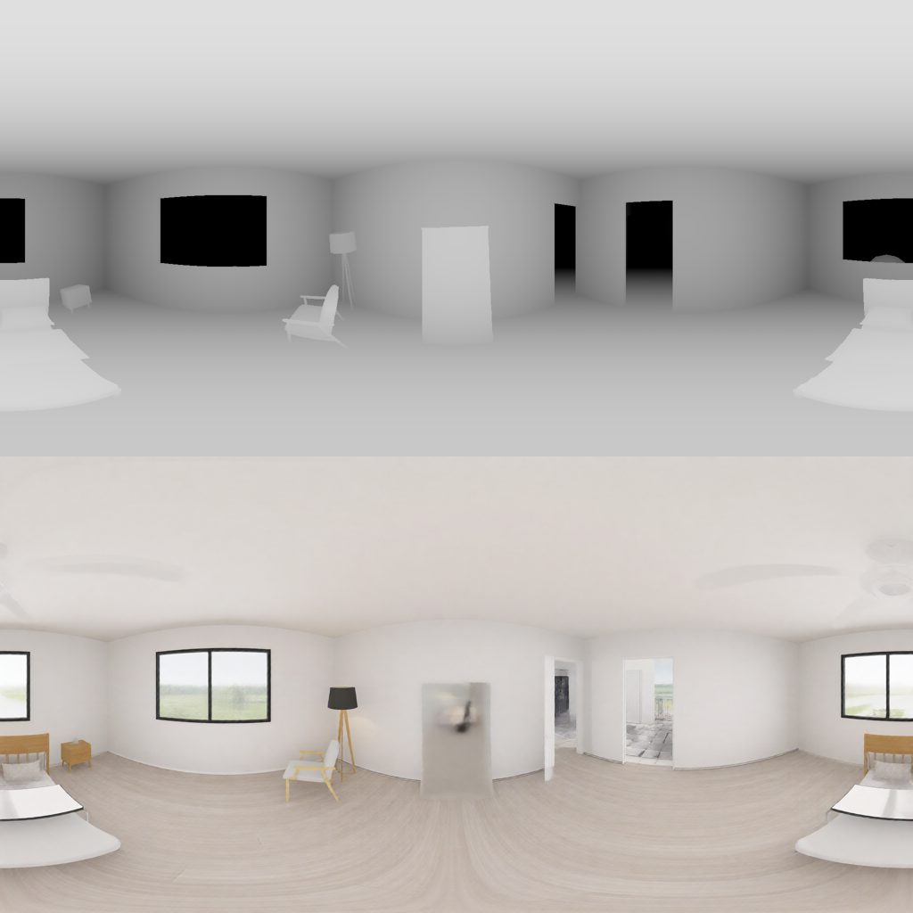

# AC-69 — the reading-corner bedroom as a 360° view on real Comfy Cloud (2026-10-18)

Video: [media/roomfit-360.mp4](media/roomfit-360.mp4) (50 s; the Cloud wait shown at 8× and labelled).

Real run: `pnpm web:dev` against `https://cloud.comfy.org`, the house the agent furnished in AC-61 (`demo/out/agent/final-state.json`), recorded by `demo/record-pano360.mjs`, cut by `demo/edit-pano360.mjs`. One click on "360° view" with Bedroom focused; no stubs.

| Step | Seconds after click |
| --- | --- |
| uploading depth panorama | 0 |
| queued | 1.3 |
| generating | 29.2 |
| downloading | 47.8 |
| done, viewer opens | 48.4 |

Top: the editor's depth panorama (real meshes, so the armchair and tripod lamp keep their shapes). Bottom: Comfy Cloud's result. The bed wraps the seam, the nightstand, the reading corner (armchair + tripod lamp), both windows and both doors are where the layout has them.

## Found by the recording (tests were green)

1. **The wardrobe becomes a smudge.** Its depth is a flat, featureless slab close to the camera; the model paints a blurred "frosted" panel with a dark blot. Visible up close in the viewer. Candidates: add the item names to the prompt per direction, add a second control (normal or canny from the same panorama), or lower control strength for large flat items. Needs a spec item before fixing.
2. The scene preset wording did not carry the warm "reading" mood (bright white room); the prompt is room name + preset and Qwen weighted the 360 trigger more. Minor.
