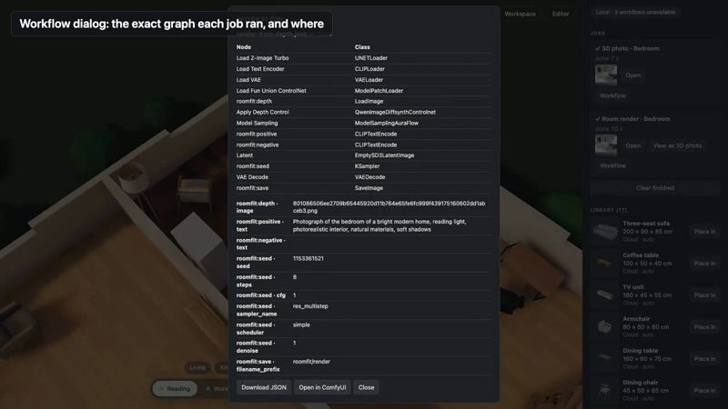

# AC-76 — render on Comfy Cloud, 3D photo on a local ComfyUI, one editor (2026-10-18)

Video: [media/roomfit-local-cloud.mp4](media/roomfit-local-cloud.mp4) (59 s, real time, no speed-up).

Scope agreed with Dante: instead of the same product on both backends (which needs ~50 GB of local models and is too slow on a Mac for Qwen 20B), show **selective use**: Cloud for what needs big models, Local for what this Mac can run. Only MoGe was installed locally (`moge_2_vitl_normal_fp16.safetensors`, 662 MB, from [Comfy-Org/MoGe](https://huggingface.co/Comfy-Org/MoGe), with Dante's OK).

Real run: `pnpm web:dev` starting on `https://cloud.comfy.org`, the local ComfyUI on this Mac at `127.0.0.1:8188` (device: MPS), the furnished house from AC-61. Recorded by `demo/record-hybrid.mjs`, cut by `demo/edit-hybrid.mjs`.

| Time | What happened |
| --- | --- |
| 5.0 s | chip "Cloud · ready" |
| 7.6 s → 18.5 s | "Render this view" on Cloud (Z-Image Turbo + ControlNet): 11 s |
| 23.6 s | "Use Local" → "Local · 3 workflows unavailable": product (`hunyuan3d-dit-v2.safetensors`, `RoomfitFitMesh`), render (Z-Image files), 360° (Qwen-Image files); Render and 360° buttons disabled with those names |
| 30.2 s → 37.6 s | "View as 3D photo" on the Cloud render → local MoGe: 7.4 s |
| 42.6 s | Workflow dialogs: `local/photo-to-3d-moge.json` · Local and `render-from-depth.json` · Cloud, node lists and filled inputs |
| 55 s | back to Cloud |

Jobs at the end: `render` backend `cloud`, `photo3d` backend `local`.

## Found by recording (tests were green)

1. **Real Cloud's catalog omits model files it runs** (Pixal3D, Trellis 2, DINOv3), so after impl-20's stricter rule the chip read "Cloud · 1 workflow unavailable" although that workflow made 14 pieces on Cloud. Fixed in impl-21 (Cloud checks node classes only; real Cloud catalog pinned as a fixture).
2. The backend menu does not close on Esc and sits over the job cards (a click on "View as 3D photo" was intercepted). Minor, polish follow-up.
3. The Workflow dialog is taller than the viewport; its title (file · backend) scrolls out of view. Minor, polish follow-up.
4. A dev server keeps the backend across editor reloads (by design); a recording that crashed on Local left the next run starting on Local.
