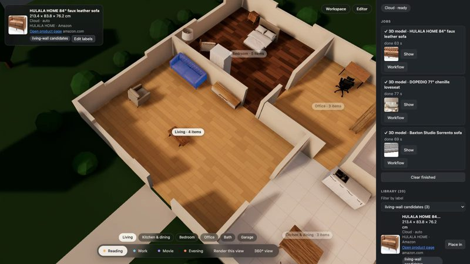

# AC-82 — three real sofas from store links, labelled, compared, placed and opened (2026-10-18)

Video (example): [media/roomfit-products.mp4](media/roomfit-products.mp4) (48 s; the Cloud wait shown at 8× and labelled). Product photos belong to their sellers and appear only as an example of the workflow.

Products picked by Claude on amazon.com at Dante's request ("아마존에서 소파 괜찮은거 골라서 해봐"), three different looks with solid ratings, listed sizes converted from inches:

| Product | Link | Listed W × D × H | Photo used |
| --- | --- | --- | --- |
| HULALA HOME 84″ faux leather sofa (camel) | amazon.com/dp/B0C2P3KPTM | 213.4 × 83.8 × 76.2 cm | white-background 3/4 shot (the main image is a staged room) |
| Baxton Studio Sorrento (grey) | amazon.com/dp/B019516ZP8 | 181 × 75.5 × 84.5 cm | main image, white background |
| DOPEDIO 71.25″ chenille loveseat (beige) | amazon.com/dp/B0CTBJB53S | 181 × 82 × 93 cm | main image, a staged room — the listing has no plain shot |

Real run: `pnpm web:dev` on `https://cloud.comfy.org`, the furnished house with its old living-room sofa removed. Recorded by `demo/record-products.mjs`, cut by `demo/edit-products.mjs`.

| Step | Result |
| --- | --- |
| Add the HULALA through the form (photo, size, link, brand, store, label) and the other two via the API, all into the garage | three Cloud product jobs in parallel; all done 78 s after the click (63 s, 69 s, 77 s per job) |
| Fit | HULALA `auto` (distortion 1.00); Baxton `exact` 1.23 and DOPEDIO `exact` 1.21, both flagged (> 1.15) — the generated models' proportions differ from the listing by about a fifth |
| Garage | the three sofas side by side at their listed sizes |
| Filter by label "living-wall candidates" | library shows the three |
| Place the HULALA in Living, select it | "Selected item" card: photo, 213.4 × 83.8 × 76.2 cm, HULALA HOME · Amazon, Open product page (amazon.com), label |
| Open product page | a new tab at amazon.com/dp/B0C2P3KPTM |

## Found by the recording

1. **Store photos are often staged rooms.** Two of three main images showed a living room with a rug and a coffee table. The Pixal3D workflow's background removal still isolated the sofa (DOPEDIO came out as the sofa with its cushions, no table), but the photo choice matters: roomfit could warn when a photo has several objects. Candidate follow-up.
2. **Proportions are off for two of three** (distortion 1.21–1.23, flagged). The exact fit forces the listed size, so placement is right, but the model looks stretched. Same issue as the demo house (AC-36/37 era); the flag works as designed.
3. **Amazon shows a bot check to the automated recording browser** instead of the product page. The link and new tab are right; the store's answer depends on the browser. Shown as is in the video, with a caption.
4. A new product is always placed (in the focused room); there is no "add to library only". The garage served as a staging area; a library-only add may be worth a spec item.
