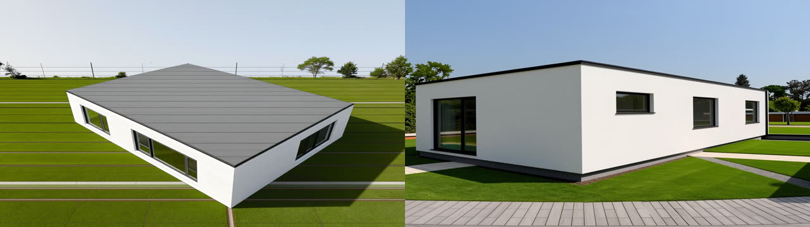

# AC-89 — Claude Code builds a house from a floor-plan image and renders it (2026-10-19)

Video: [media/roomfit-blueprint.mp4](media/roomfit-blueprint.mp4) (68 s; waits sped up and labelled). Prompt: [prompts/agent-02-blueprint-house.txt](prompts/agent-02-blueprint-house.txt). Plan: [media/ac89-floor-plan.png](media/ac89-floor-plan.png) — a 12 × 9 m two-bedroom house drawn for this test (not the demo house).

Setup as AC-61: the editor open on an empty lot (`demo/record-agent.mjs` with `DEMO_LAYOUT`), `claude -p` with `.mcp.json` (roomfit + comfy-cloud), allowed tools `mcp__roomfit`, `mcp__comfy-cloud`, `Read`.

## Three takes

| Take | Time · turns · cost | Plan (plan-diff vs the drawing's source, origin aligned) | Exterior renders |
| --- | --- | --- | --- |
| 1 | 4 min 55 s · 47 · $1.79 | exact (8/8 walls, 11/11 openings, 5/5 rooms, 0 cm) | failed: a façade with a floating board, glass bubbles, one wall with the door as a window |
| 2 (after impl-25, impl-26) | 2 min 22 s · 25 · $1.05 | exact | aerial right; street drew two storeys |
| 3 (after impl-27) | 2 min 34 s · 31 · $1.29 | exact | both single-storey, flat roof, two façades in the street view |

Each failing take became a spec change with a red test and an implementation session (see `spec/M9-blueprint-to-house.md` §7 and `docs/recordings/impl-25..27`). The agent's own reports named the suspects each time (take 1: "the exterior shot code added after the spike"; impl-25: "the lawn nearer than the house clips to white" — which turned out to be take 2's cause).

## What else the runs showed

1. **The plan is the easy part.** All three takes read the drawing exactly from the printed 12.00 m / 9.00 m dimension lines (0.909 cm/px), checked the walls against the underlay with screenshots, and chose floors and window heights the drawing does not give (and said so).
2. **Exterior renders are where real data bit.** The spike (studio camera, no roof) looked fine; the specified shot did not, three times, for three different reasons (framing/contrast, roof read as a board from 45°, ground clipped to white). Tests could only check the geometry of the shot; the look needed real Cloud renders.
3. **Test-design slip (mine):** the drawing's source plan sat next to the image as `truth-room.json`. Takes 1 and 2 left it alone ("looks like the answer key"); take 3 opened it after building, to verify, and said so. The result was already exact, but the reference file should live where the agent cannot read it.
4. A prompt alone could not turn a two-storey guess into one storey (two seeds, `demo/spike-storeys.ts`); fixing what the depth image says did.
