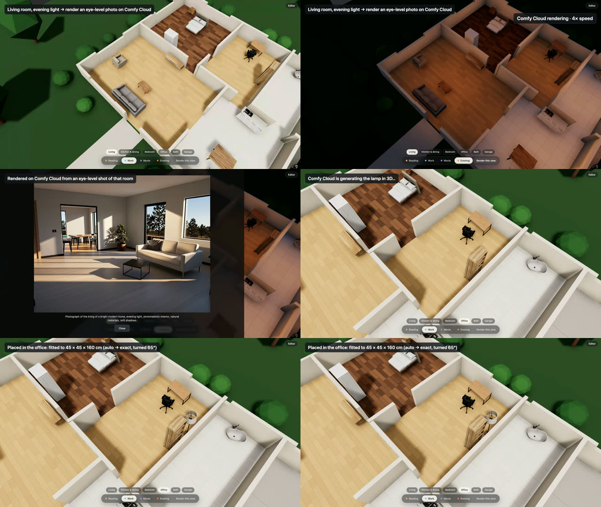

# House walkthrough on real Comfy Cloud (2026-10-18)

Video: [media/roomfit-walkthrough.mp4](media/roomfit-walkthrough.mp4) (34 s; Cloud waits shown at 4× and 6× and labelled). Recorded by `demo/record-walkthrough.mjs` (headless Chrome on Metal, 1600×900), real Comfy Cloud through the dev proxy.

| Step | Real time |
| --- | --- |
| Whole house, Work light, slow orbit | — |
| Living room chip → Evening → "Render this view": eye-level shot (AC-46) rendered on Cloud | 16 s |
| Office chip → floor lamp from a product photo, `auto` fit (exact, turned 65°), `findSpot` puts it against the east wall; cutaway walls (AC-45) keep it visible | 33 s |
| Back to the whole house, Evening | — |

The first take of this walkthrough (same day) is what produced AC-45 and AC-46: the room render looked like an overhead miniature, and the lamp was hidden behind a full-height wall. All tests were green at the time.
