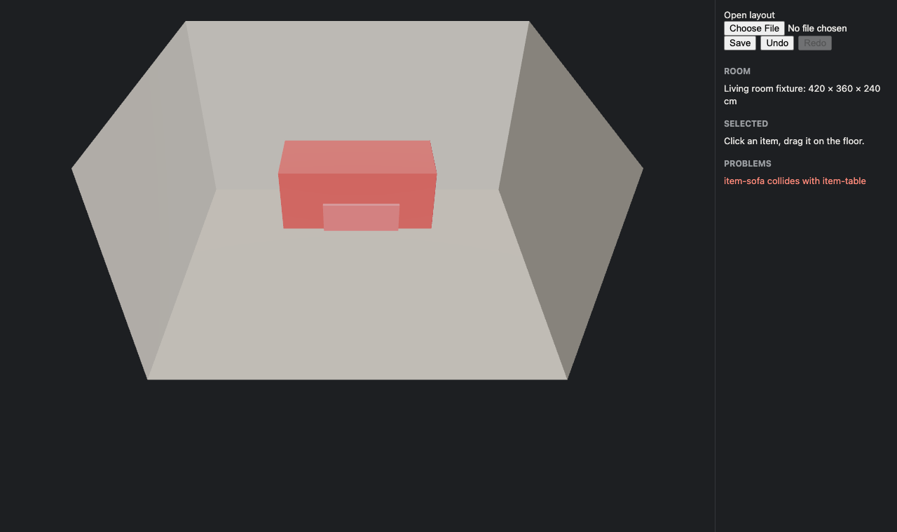
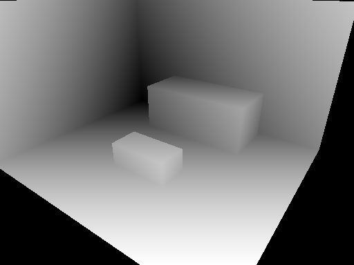
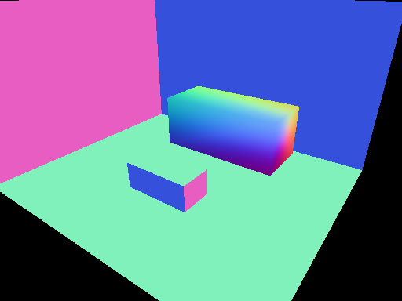
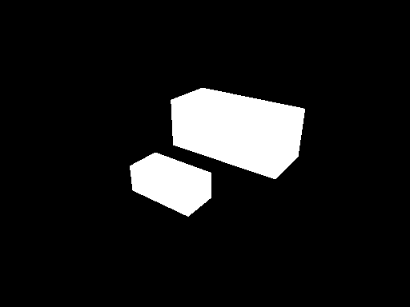

# impl-03-editor

- Started: 2026-10-18T04:38:01.818Z
- Duration: 611 s · Turns: 65 · Cost: $2.81
- Tool calls: Skill 1, Bash 19, Read 17, Write 10, Edit 14, ToolSearch 1, TaskStop 1
- Stop hook sent the agent back: 0 · Guard blocks: 0
- Raw transcript (local only): `.recordings/impl-03-editor.jsonl`

## Prompt

> spec/M1-scaled-furniture.md 의 에디터 AC들(AC-9, AC-14~AC-17)을 초록으로 만들어줘. web/ 아래에 에디터를 새로 만들어야 해. 계약은 spec/contracts/editor-api.ts, 결정은 docs/adr/0004 를 봐. AGENTS.md 규칙을 따르고, 끝나면 무엇을 했는지 짧게 알려줘.

## Agent's final message

에디터 AC 다섯 개(AC-9, AC-14~AC-17)가 모두 PASS이고, `pnpm verify`가 `VERIFY PASS`를 출력합니다. 작업 전에는 다섯 개 모두 `NO TEST`였습니다. 보호 경로는 건드리지 않았고 커밋은 하지 않았습니다.

**만든 것 (`web/` 신규)**
- **`window.roomfit` 구현** (`editor.ts`): 계약 `RoomfitEditorApi` 전체를 구현했습니다. 드래그, Q/E 회전, Delete 키, Cmd/Ctrl+Z 같은 UI 조작도 모두 이 함수들을 그대로 호출합니다.
- **편집과 이력** (`edits.ts`, `history.ts`): 이동·회전·삭제는 순수 함수이고 스냅은 `packages/placement`의 함수를 그대로 씁니다. 실행 취소/다시 실행은 레이아웃 전체 스냅샷을 쌓는 방식이고, 드래그 한 번은 이력 한 칸으로 합쳐집니다(ADR-0004에서 열어둔 부분).
- **충돌·벽 밖 판정**: 메시 크기가 아니라 `collisions`/`outOfBounds`가 계산한 결과로 강조 표시합니다.
- **렌더 패스 출력** (`passes.ts`): 각 메시의 재질을 임시로 바꿔 깊이, 카메라 기준 노멀, 마스크 PNG를 렌더링합니다. 깊이는 float 렌더 타깃에 담은 뒤 가장 가까운 점부터 가장 먼 점까지 선형으로 0~255에 매핑합니다.
- **화면 구성** (`App.tsx`, `main.tsx`, `meshes.ts`): 바닥과 벽 네 개를 그리고, GLB를 cm 단위 장면에 맞게 100배로 키워 배치합니다. GLB를 못 불러오면 등록 치수 크기의 박스로 대신 보여줍니다. 오른쪽 패널에서 열기, 저장, 실행 취소, 문제 목록을 볼 수 있습니다.
- **Vite 설정** (`web/vite.config.ts`): `/fixtures/`를 서빙하는 작은 미들웨어(경로 탈출 차단 포함)를 넣었고, 호스트를 `127.0.0.1`로 고정했습니다. 고정 전에는 macOS에서 서버가 IPv6로 떠서 Playwright가 서버를 찾지 못하고 타임아웃났습니다.
- **`.gitignore`**: `web/dist/`를 추가했습니다.

**판단이 필요했던 지점**
- **소파 fixture GLB는 삼각형이 안쪽을 향하고 노멀이 없습니다.** 그래서 처음에는 마스크 중앙이 검게 나와 AC-9가 실패했습니다. 이미지→3D 모델 출력도 면 방향이 뒤집힌 경우가 흔하다고 보고, fixture를 BLOCKED로 올리지 않고 가구 메시를 양면으로 렌더링하고 없는 노멀은 계산하도록 했습니다. 출력한 패스 이미지를 직접 열어 확인했습니다. fixture를 바깥 방향으로 고치는 게 맞다고 보시면 spec 세션에서 고치면 됩니다.

확인하지 않은 것도 있습니다. 실제 마우스 드래그와 단축키는 손으로 테스트하지 않았습니다. 패스 출력 크기를 잘못 넘기면 `RangeError`로 실패하는데, 계약에 실패를 데이터로 돌려줄 자리가 없어 예외를 택했습니다.

## Reviewer notes

- Verified independently: VERIFY PASS with editor build + e2e gates; 15 active ACs pass.
- Agent found a fixture bug of the spec session: fixture GLB triangles wind inward and have no normals, so the mask pass came back black. It chose double-sided rendering + computed normals (robust for generated meshes) and reported it instead of editing fixtures.
- Agent dumped the three passes as PNGs and looked at them to debug (See role in use).
- Agent fixed a macOS IPv6 localhost vs 127.0.0.1 mismatch between Vite and Playwright.
- poteto-mode skill loaded (user-level pstack SessionStart hook); no playbook read, no subagents, no principle citations in the reply.
- Screenshots: media/editor-ok.png, media/editor-collision.png, media/pass-{depth,normal,mask}.png (captured by reviewer).

| depth | normal | mask |
| --- | --- | --- |
|  |  |  |
