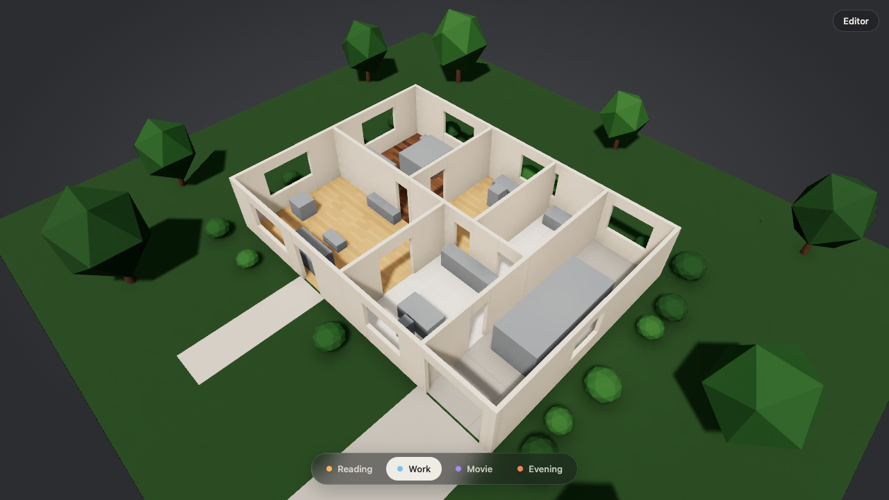
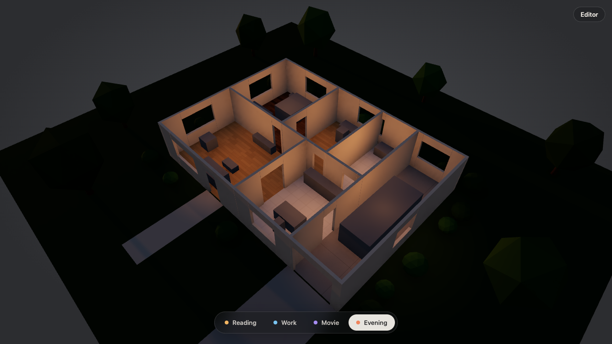

# impl-08-studio

- Started: 2026-10-18T12:38:59.383Z
- Duration: 749 s · Turns: 72 · Cost: $2.95
- Tool calls: Bash 24, Read 13, Write 3, Edit 31
- Stop hook sent the agent back: 0 · Guard blocks: 0
- Raw transcript (local only): `.recordings/impl-08-studio.jsonl`

## Prompt

> spec/M2-home-studio.md 의 빨간 AC들(AC-32~AC-34)을 초록으로 만들어줘. 스튜디오 뷰야. 결정은 docs/adr/0007 을 봐.

목표 화면(레퍼런스: Meng To가 2026-10-15에 X에 올린 집 데모)을 말로 설명하면:
- 지붕 없는 단층 집 전체를 남동쪽 위에서 3/4 각도로 내려다본다. 벽은 두께가 보이게 잘려 있고 크림색/따뜻한 회백색 회벽 느낌.
- 방마다 바닥 재질이 다르다: 거실·서재 밝은 오크, 침실 짙은 월넛, 주방·욕실 연한 타일, 차고 콘크리트.
- 해가 낮게 들어오는 따뜻한 오후 빛, 부드러운 긴 그림자, 앰비언트 오클루전으로 가구 밑과 벽 모서리가 살짝 어둡다. 필르믹 톤매핑.
- 집 밖: 짙은 초록 잔디, 차고 앞 콘크리트 진입로, 현관 앞 보도, 둥근 관목과 키 큰 나무 몇 그루(로우폴리여도 됨). 배경은 어두운 회색.
- 화면 하단 가운데에 반투명 알약 모양 바: 색 점이 있는 Reading / Work / Movie / Evening 버튼. 선택된 건 강조.
- 에디터 사이드 패널은 스튜디오 뷰에서 숨기거나 접고, 3D가 화면 대부분을 차지한다. 에디터로 돌아가는 작은 토글 버튼 하나.

AGENTS.md 규칙을 따르고, 네트워크 자산은 쓰지 마. 끝나기 전에 Work와 Evening 스크린샷을 직접 찍어서 위 설명과 비교하고, 무엇을 했는지 짧게 알려줘.

## Agent's final message

AC-32, AC-33 and AC-34 now pass, and `pnpm verify` prints `VERIFY PASS` with every other AC still passing. I didn't commit anything.

**What changed**
- **Studio camera** (`web/src/framing.ts`, `editor.ts`): `setView('studio')` immediately places the camera south-east of the house, 47° up and about 22 m away, so the whole house plus its yard fits on screen. Orbiting is damped, and the camera can't go below the ground.
- **Studio scene** (`web/src/studio.tsx`):
  - **Sun:** a directional sun with soft shadows. Its direction, colour temperature (K) and intensity follow the preset table exactly.
  - **Interior lights:** one warm point light near the ceiling of each room.
  - **Ambient light:** it turns bluish as the sun drops, so the outside isn't pitch black in Evening.
  - **Presets:** switching eases toward the new lighting over about 1 s, while `lighting()` reports the target values immediately.
  - **Look:** ambient occlusion (N8AO) and ACES filmic tone mapping.
- **Landscape:** a dark green lawn and a dark gray background (a CSS gradient behind the canvas). Exterior doors get paths worked out from the layout data: the wide one (the garage) gets a concrete driveway, the others a walkway. Low-poly trees and round shrubs are scattered in a fixed pattern and kept off the paths.
- **Materials** (`web/src/floors.ts`): floors are textures drawn in the browser — oak and walnut planks, tile, concrete — and nothing is downloaded. Walls are cream plaster, and their ends now meet at the corners with no gaps.
- **UI:** a translucent pill bar at the bottom centre with coloured dots for Reading, Work, Movie and Evening; the active one is highlighted and has `aria-pressed`. In studio view the side panel is hidden but keeps its state, and a small Editor / Studio button sits at the top right.

**Screenshot check** (`.harness/e2e-output/studio-work.png`, `studio-evening.png`)
- **Work:** matches the description: cut walls with visible thickness, a different floor in each room, a green lawn on a dark gray background, the walkway and driveway, trees and shrubs, and the bottom bar.
- **Evening:** the outside goes dark with bluish light on the outer walls, and the rooms glow warm orange.
- **Where it falls short of the reference:**
  - The furniture is gray boxes, because the fixture's models are still box stand-ins.
  - The walls render closer to white than cream.
  - Work's shadows are short: the table puts the sun at 55°. Reading, at 35°, has longer ones.
  - Ambient occlusion is subtle.
  - In Evening the interior lights also leak a little onto the grass right next to the house, because they cast no shadows.

I didn't check orbiting by hand, how fast it runs on a real GPU (I only checked with the software renderer the tests use), or the Reading and Movie screenshots. The 3D scene's own background colour never appeared on screen, so the gray is a CSS background and stays the same across presets.

## Reviewer notes

- Verified independently: VERIFY PASS; AC-32~34 pass; all earlier ACs still pass.
- Agent compared its own Work/Evening screenshots against the written description of the reference (See role) and fixed wall corner gaps.
- Everything procedural (canvas-drawn floor textures, low-poly greenery); AC-34 confirms no network requests.
- Furniture are still box stand-ins; generated models need Comfy Cloud credits (asked).

| Work | Evening |
| --- | --- |
|  |  |
