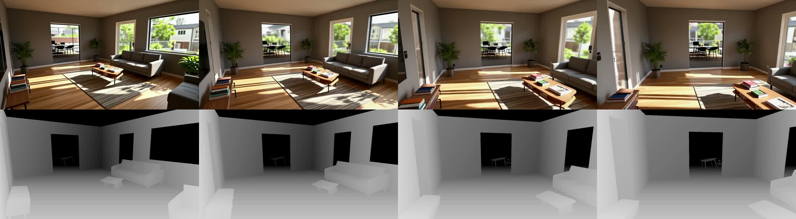

# M17 — Walkthrough video: a photoreal clip that moves through your layout

| | |
| --- | --- |
| Status | Approved (2026-10-20) |
| Date | 2026-10-20 |
| Owner | Dante |
| Decisions | [ADR-0015](../docs/adr/0015-walkthrough-video-from-a-layout-depth-video.md) |
| Spike | [docs/spikes/m17](../docs/spikes/m17) |

## 1. Why

**A render is one frame; people share a walkthrough.** README has listed "a video walkthrough job" as 🧪 planned since M10. "Render this view" gives one eye-level photo (M2, M13). The 360° view (M5) lets you look around from one standing point. Neither shows what it is like to walk into the room. Dante picked this as the next milestone (2026-10-20).

**It has to stay this layout.** M5 rejected video models because they were "paid or not layout-conditioned". The Comfy Cloud catalog now has an open, layout-conditionable option: `video_ltx2_3_ic_lora`, LTX-2.3 22B (distilled fp8) with the IC-LoRA Union Control. It takes a first frame and a frame-aligned control video (depth, pose or edges), runs no paid API nodes and costs 0 credits.

**The spike passed (2026-10-20, §7).**
- **Input:** a 121-frame depth video rendered by the editor along a 4.8 s path through the furnished demo living room, plus a first frame from the existing `render-from-depth` workflow on frame 0's depth.
- **Result:** a 1280×704, 25 fps clip. The sofa, coffee table, rug, windows and the doorway to the dining table stay where the layout has them while the camera dollies and pans.

## 2. Goals and non-goals

Goals
- From a focused room in the studio, **"Walkthrough video"** generates a ~5 s photoreal clip along a short eye-level path through that room. The clip is conditioned on depth rendered from the current layout.
- The clip plays in a viewer with Download. It runs as a normal job card (M3), and agents get it as an MCP tool (M4).
- Off by default. Each generation is a deliberate click, with the expected time shown.

Non-goals (M17)
- **User-drawn or recorded camera paths** (record the M15 walk and replay it). M17 uses one fixed path per room. Recording a walk is the natural follow-up once the pipeline exists.
- **Clips longer than ~5 s, and multi-room tours.** LTX-2.3 IC-LoRA was proven at 121 frames. Chaining clips (last frame → next first frame) is a follow-up.
- **Audio.** LTX-2.3 can generate sound; the workflow keeps it off.
- **Testing the local backend on real hardware.** The models are ~38 GB (checkpoint 27.5 GB, Gemma 3 12B text encoder 8.8 GB, IC-LoRA, MoGe). The local set gets its own copy of the workflow without `MoGeInference.refine_steps`, which the 2026-08 local ComfyUI lacks and MoGe-2 ignores. Readiness (M10) names missing model files. Only Cloud is recorded in M17.
- **Saving clips in the layout file.** Clips stay with the session's jobs, like panoramas (M5).

## 3. Scenarios

1. **Walk into the living room.**
   - Dante focuses Living and clicks **Walkthrough video**.
   - A job card "Walkthrough · Living" appears (expected ~3 min) and goes through: rendering path → first frame → uploading → queued → generating → downloading → done.
   - When it finishes, the viewer opens and plays the clip. The camera moves from the room's eye-level shot past the sofa toward the far side.
   - **Download** saves `comfysims-walkthrough-living.mp4` (the extension of the file the backend saved); **Close** returns to the studio.
2. **Stale clip.** After he moves the sofa, the Living walkthrough's job card says "Layout changed since this video" and offers **Regenerate**. The old clip still plays.
3. **Agent.** Asked "Make me a walkthrough of the bedroom", the agent calls `walkthrough_video({ room: "bedroom" })` and gets back the saved mp4 path, the first frame as image content and the job id.

## 4. Screens and states

- **Studio bottom bar:** **"Walkthrough video"** sits after "360° view".
  - Disabled, with the tooltip "Focus a room first", when no room is focused.
  - Disabled, with the backend's missing-model message (M10), when the selected backend cannot run `walkthrough`.
- **Job card, kind `walkthrough`:**
  - Title: "Walkthrough · <room>".
  - Steps: `path` (editor renders the depth frames) → `first-frame` (a `render-from-depth` run on frame 0) → uploading → queued → generating → downloading → done.
  - Actions: **"Open"** and **"Regenerate"**. A failure shows the server message and **"Retry"** (M3 rules).
- **Viewer:** a full-window dialog named **"Walkthrough"**.
  - A `<video>` that autoplays muted and loops, with native controls.
  - **"Download"**, plus **"Close"** and Esc to close.
  - A stale clip shows "Layout changed since this video" in the viewer as well as on the job card.
- The viewer opens by itself when a `walkthrough` job finishes, like the 360° view.

## 5. Behaviour rules

**Path** (one per room, deterministic):
- Starts at the room's eye-level shot, the same camera as "Render this view" with a focused room.
- Over 121 frames at 25 fps (4.84 s), the eye dollies forward along its view direction and the yaw pans +25°, both with smoothstep easing (`t²(3 − 2t)`). Eye height and pitch stay fixed.
- **Dolly length:** 160 cm, shortened in 10 cm steps until every frame's eye stays inside the room polygon and clears the M15 walk obstacles (walls by ≥ 25 cm, furniture ≥ 50 cm tall). If even 40 cm fails, the path is a pure pan.
- A pure function `walkthroughPath(zone, layout) → CameraPose[121]` in `packages/motion`.

**Depth video:**
- Each frame is a depth pass from that frame's pose, using the same lens as the render pass (fov 50°, no view offset) at 1280×704.
- Depth uses a **fixed** range of 40–900 cm for every frame, so grey levels don't flicker as the range changes.
- The editor encodes the frames to VP9 WebM at 25 fps in the browser (WebCodecs `VideoEncoder` + `mediabunny`'s WebM muxer) and uploads it through `/api/upload/image`, which takes video files on Cloud (checked 2026-10-20).
- `walkthroughDepthVideo(zoneId)` returns that video, for tests and agents.

**First frame:** the `render-from-depth` workflow on frame 0's depth image (the same fixed-range depth as the video's frame 0, as PNG) at 1280×704. It uses the room's scene prompt (M13 `scenePrompt`, current preset and render style) and the job's seed.

**Generation:**
- `walkthrough-ltx23-ic-lora.json` gets the first frame, the depth video and a prompt.
- **Prompt:** `"A slow, steady camera walkthrough of "` + the room's scene prompt + `". The camera dollies forward and pans gently. The room stays still; no people."`.
- A caller's own prompt (MCP `prompt`) replaces the room part.

**Limits and staleness:**
- One `walkthrough` job per room at a time. Each counts toward `MAX_CONCURRENT_JOBS`.
- A clip remembers the layout revision it was made from. Any later change to items in that room marks it stale (as M5).
- Clips are never regenerated automatically.

## 6. Contract and data changes

- **Schema:**
  - `JobKind` gains `walkthrough`; `JobStep` gains `path` and `first-frame`; `Job.result` gains `video`.
  - `DEFAULT_EXPECTED_SECONDS.walkthrough = 120`. Measured: the clip took 39–97 s from queue to done on Cloud, plus about 10 s for the first frame. The M10 history replaces the default after the first runs.
- **`workflows/sets.json`:** `cloud.walkthrough` is `cloud/walkthrough-ltx23-ic-lora.json`, and `local.walkthrough` is `local/walkthrough-ltx23-ic-lora.json`.
- **Editor API** (`spec/contracts/editor-api.ts`):
  - `walkthroughPath(zoneId)` → `{ poses; dollyCm }`, built by the pure `walkthroughPath(start, blocked)` in `packages/motion`.
  - `walkthroughDepthVideo(zoneId)` → `{ video (blob URL), frames, width, height, fps }`.
  - `walkthrough({ zoneId?, prompt?, seed? })`. It uses the focused room when no `zoneId` is given, and returns `no-room` when there is neither.
  - `openWalkthrough(jobId)` and `closeWalkthrough()`.
  - `state().walkthroughViewer = { jobId, zoneId, stale } | null`.
  - Job `result = { video (blob URL), firstFrame (blob URL) }`.
- **MCP:** `walkthrough_video({ room, prompt?, preset?, seed? })` waits for the job, then returns `{ jobId, path }` plus the first frame as image content. `spec/contracts/mcp-tools.json` gains it.
- **Dependency:** `mediabunny` 1.61.3, a dev dependency (bundled into the editor like `three`).
- **Fake ComfyUI:** keeps the extension of uploaded videos, serves `/__uploads/<name>` and lists `LoadVideo` files in `/__prompts`. It answers `SaveVideo` with `fixtures/videos/walkthrough-living.webm`. The local fake lacks the LTX-2.3 checkpoint and IC-LoRA.
- No breaking changes. AC-72 and AC-75 gain the new kind.

## 7. ComfyUI workflows

**New `workflows/cloud/walkthrough-ltx23-ic-lora.json`**: the API graph that ran on Cloud as job `cd756248` (from the `video_ltx2_3_ic_lora` template), pinned as our own file.
- **Nodes:** LTX-2.3 22B distilled fp8, the Gemma 3 12B text encoder with its LoRA, IC-LoRA Union Control (ref 0.5, strength 1.0), the MoGe video-depth branch (kept: it is what the spike proved), and `SaveVideo`.
- **Removed from the template:**
  - The prompt-enhance branch (`TextGenerateLTX2Prompt` and its switch). The spike's first run showed it leaks the template's jungle demo prompt.
  - The audio output, so the clip has no sound track.
- **Tags:**
  - `roomfit:first-frame` (LoadImage)
  - `roomfit:control-video` (LoadVideo)
  - `roomfit:positive` (the one `CLIPTextEncode` the sampler uses)
  - `roomfit:seed`
  - `roomfit:save`, with prefix `roomfit/walkthrough`.
- **Proof it runs:**
  - The pinned file ran on Cloud as job `19ba4310`: 59 s queue to done, an H.264 mp4 at 1280×704, 121 frames.
  - It ran again with a VP9 WebM control video as job `06709909` (39 s), with the same result.
- **Local:** `workflows/local/walkthrough-ltx23-ic-lora.json` is the same graph without `MoGeInference.refine_steps`.
- **Lint:** both files lint against their catalog snapshots.
  - The Cloud snapshot gains the 26 nodes, with input specs from the live Cloud `/api/object_info`.
  - The local snapshot already listed the classes; it was regenerated from the 2026-08-23 local checkout with no change.
  - The linter now accepts ComfyUI V3 dynamic sub-inputs (`format.codec`, `values.a`) and match-type links, with self-tests.

### Spike result (2026-10-20) — PASS

The demo furnished house (`demo/out/house/furnished-layout.json`, 17 generated pieces), Living room, from the eye-level shot: dolly 160 cm + pan 25°, 121 frames, depth 40–900 cm. Capture script: [`docs/spikes/m17/capture-depth.mjs`](../docs/spikes/m17/capture-depth.mjs).

| Run | Cloud job | First frame | Result | Verdict |
| --- | --- | --- | --- | --- |
| v1 | `4bc0fceb` | "Render this view" at the eye-level shot (renders with an auto depth range and a slightly different framing) | geometry follows the depth, but the scene jumps after frame 0, and vines and stone appear on the far wall (template prompt leaked through `CLIPTextEncode`) | fail: two causes found |
| first frame | `db5bd6fa` | `render-from-depth` on frame 0's depth, 1280×704, seed 17 | matches the depth composition | used for v2 |
| v2 | `cd756248` | the matched first frame; prompt set on both text nodes | sofa, coffee table, rug, windows and the dining table through the doorway stay put for 4.8 s; light and materials stay consistent | **PASS** |

- **Evidence:** [`walkthrough-v2-with-depth.mp4`](../docs/spikes/m17/walkthrough-v2-with-depth.mp4) (clip over depth), [`walkthrough-v1-template-prompt-leak.jpg`](../docs/spikes/m17/walkthrough-v1-template-prompt-leak.jpg), [`first-frame-vs-depth.jpg`](../docs/spikes/m17/first-frame-vs-depth.jpg).
- **Found:**
  - The armchair at the right edge fades out in the last 30 frames. Items that leave the frame are not held.
  - The depth video goes through MoGe again. It works, but it adds a model and some seconds of compute; see open question 2.

## 8. Acceptance criteria

| AC | Status | Criterion |
| --- | --- | --- |
| AC-136 | active | `walkthroughPath` returns 121 poses at the eye-level shot's height. Every eye is inside the room and clears walls by ≥ 25 cm and furniture ≥ 50 cm tall. The first pose is the eye-level shot. It shortens the dolly in 10 cm steps when blocked, and falls back to a pure pan below 40 cm |
| AC-137 | active | `walkthroughDepthVideo` gives a VP9 WebM of 121 frames at 25 fps, 1280×704. The video the job uploads opens on the same depth the first frame was rendered from (mean grey difference < 6) |
| AC-138 | active | "Walkthrough video" is disabled with no focused room. With one, it runs a `render-from-depth` first frame, then queues `walkthrough-ltx23-ic-lora` with that frame, the depth video and the walkthrough prompt. The job card goes through the steps in §4 in order |
| AC-139 | active | When the job finishes, the viewer opens and plays the clip, muted and looping. Download saves `comfysims-walkthrough-<room>.<saved extension>`; Close and Esc close it |
| AC-140 | active | Moving an item in the room marks that room's clip stale. "Regenerate" queues a new job; nothing regenerates automatically |
| AC-141 | active | The `walkthrough_video` MCP tool returns the saved clip path and the first frame as image content, and is listed in `mcp-tools.json` |
| AC-142 | active | `walkthrough-ltx23-ic-lora.json` lints against the Cloud catalog snapshot and carries every `roomfit:` tag in §7 |
| AC-143 | active | A backend without the LTX-2.3 models reports them in `backend.unavailable`, and the button is disabled with that message; on Cloud it is enabled |
| AC-144 | manual | Recording on real Comfy Cloud: a walkthrough of the demo living room and bedroom, played in the viewer. Evidence goes in `docs/recordings/` |

## 9. Test plan

| AC | Level |
| --- | --- |
| AC-136 | vitest on the pure `walkthroughPath(start, blocked)` (open, wall ahead, pan only); e2e on the editor's path, checking each eye with `walk()` |
| AC-137 | e2e: demux with `mediabunny` in Node; decode frame 0 in the browser and compare with the uploaded depth PNG |
| AC-138, AC-139, AC-140 | e2e with the fake ComfyUI, which returns a fixture WebM and a first-frame PNG |
| AC-141 | e2e via the MCP SDK client (as AC-67) |
| AC-142 | vitest (as AC-68) |
| AC-143 | e2e with the local fake, which lacks the LTX checkpoint and IC-LoRA |
| AC-144 | manual recording |

## 10. Risks and open questions

Risks
- **Encoding in the browser.** WebCodecs VP9 encoding is in Chrome, Edge and Firefox, and in Safari 17+. Where `VideoEncoder` is missing, the button is disabled with "This browser cannot encode video".
- **Runtime and cost.** One LTX 22B run per clip. It is opt-in and labelled stale, as with M5, and the job card shows the expected time.
- **Items leaving the frame drift** (spike found). The path pans only 25° to limit how much leaves the view.
- **The template can change.** Cloud templates are re-published, so the workflow is pinned as our own API-format file (§7), not a template reference.

Open questions: settled 2026-10-20 on the recommended answers (Dante: "권장안대로 승인"), with one change from a measurement:
1. **Encoder:** WebCodecs + a muxer, as recommended, but **VP9 WebM with `mediabunny`** instead of H.264 mp4 with `mp4-muxer`. Playwright's Chromium cannot encode H.264 without a GPU or play it at all, so an mp4 depth video could not be tested on CI. Cloud accepted the WebM (job `06709909`). `mp4-muxer` is deprecated in favour of `mediabunny`. See ADR-0015.
2. **MoGe branch:** kept for M17.
3. **Path:** one fixed dolly + pan per room.
4. **Credits:** 0 credits; 6 Cloud jobs in total (spike and workflow checks).

## Change log

- 2026-10-20 Draft from Dante's choice of the walkthrough video as M17. Spike run the same day (3 Cloud jobs), PASS on the second attempt. In review.
- 2026-10-20 Approved on the recommended answers. Spec session: pinned Cloud and local workflows (Cloud jobs 19ba4310, 06709909), Cloud catalog snapshot, linter support for V3 dynamic inputs, schema and contracts, fake ComfyUI video support and fixture, tests for AC-136~143. The depth video changed from H.264 mp4 to VP9 WebM after measuring (ADR-0015). ACs active.
