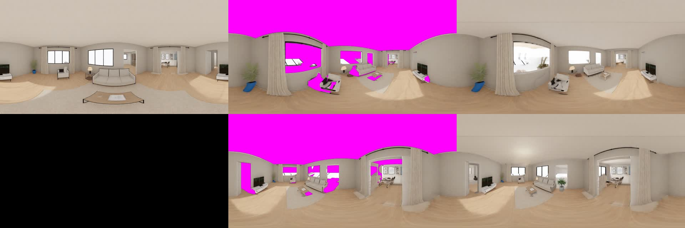

# M18 — Photoreal walk: walk your layout in real time, painted with generated 360° views

| | |
| --- | --- |
| Status | In review |
| Date | 2026-10-21 |
| Owner | Dante |
| Decisions | ADR-0016 (written on approval) |
| Spike | [docs/spikes/m18](../docs/spikes/m18) |

## 1. Why

**Dante wants to walk around like in a game, and see the real thing** ("내가 실제로 게임처럼 돌아다니면 좋겠는데", 2026-10-21). Today ComfySims offers three ways to look at a room:
- **Walk mode (M15):** real time with WASD, but the room is the low-poly 3D model.
- **360° view (M5):** photoreal, but from one fixed point.
- **Walkthrough video (M17):** photoreal, but a 5 s clip on a fixed path.

No mode is both photoreal and free to move.

**The geometry and the cameras are already exact.** ComfySims knows every wall, opening and piece of furniture at real size, and where each generated view was taken from. A generated 360° panorama can therefore be projected back onto the real geometry and walked through at full frame rate. Parallax comes from the geometry; the look comes from the panorama.

**The spike (2026-10-21, §7) showed it works once the views agree.**
- **One panorama:** near its standing point the sofa, walls, curtains and door look photoreal in real time. A metre away, surfaces it never saw open up (behind the sofa, window reveals).
- **Three independent panoramas:** cover those holes, but they disagree. The sofa, wall and rug change colour from one view to the next.
- **Warp + inpaint:** the 2nd and 3rd panoramas are made by warping what the earlier views saw to the new standing point and generating **only the holes**. The three views then read as one room.

## 2. Goals and non-goals

Goals
- **"Photoreal walk"** on a focused room builds a photoreal skin for that room from up to 3 consistent generated 360° views. In walk mode the room is drawn with it at full frame rate.
- **Surfaces no view saw keep the 3D material**, so nothing turns black or purple.
- **Opt-in.** Each build is one deliberate click with its expected time. It runs as a job card (M3), and a toggle switches the skin off.
- **Moving furniture** reverts that piece to its 3D material and marks the room's skin stale. Nothing regenerates automatically.

Non-goals (M18)
- **Relighting or view-dependent reflections.** The light is baked into the panoramas.
- **Whole-house skins in one click.** M18 builds one room at a time; walking into another room shows that room's skin if it has one.
- **Gaussian splats and trained radiance fields.** Comfy Cloud has no training node, and moving furniture would mean retraining (ADR-0016 alternatives).
- **An MCP tool.** Agents keep `view_360` and `walkthrough_video`.
- **Saving skins in the layout file.** They stay with the session's jobs (as M5).

## 3. Scenarios

1. **Build and walk.**
   - Dante focuses Living and clicks **Photoreal walk**.
   - A job card "Photoreal walk · Living" goes through: view 1 of 3 → view 2 of 3 → view 3 of 3 → done (expected ~2 min).
   - When it finishes, the editor enters walk mode in that room with the skin on. He walks with WASD: the sofa, rug, walls and curtains look like the photos while he moves around them.
2. **Toggle.** The walk bar's **Photoreal** toggle switches the skin off and back on, so he can compare.
3. **Move furniture.** He leaves walk mode and moves the armchair.
   - The armchair shows its 3D material in walk mode, and the rest of the room keeps the skin.
   - The job card and the walk bar say "Layout changed since this skin" and offer **Regenerate**.

## 4. Screens and states

- **Studio bottom bar:** **"Photoreal walk"** sits after "Walkthrough video".
  - Disabled, with the tooltip "Focus a room first", when no room is focused.
  - Disabled, with the backend's missing-model message (M10), when the backend cannot run the workflows.
- **Job card, kind `skin`:**
  - Title: "Photoreal walk · <room>".
  - Steps: `view` (repeated, labelled "view n of N") → uploading → queued → generating → downloading → `done`.
  - Actions: **"Walk"** (enter walk mode in the room with the skin on) and **"Regenerate"**. Failure shows the message and **"Retry"**.
- **Walk bar:** while walking in a room that has a skin, the walk bar shows a **"Photoreal"** toggle (on by default after a build).
  - A stale skin shows "Layout changed since this skin" and **Regenerate** next to it.
- **The ceiling.** Walk mode draws each room's ceiling at wall height (today the studio has none), so the skin has a ceiling to paint.

## 5. Behaviour rules

**Viewpoints** (pure, `packages/motion`: `skinViewpoints(zone, blocked)`):
- View 1 is the room's 360° standing point (M5).
- Views 2 and 3 are walkable points (M15 walker rule) inside the room, chosen greedily on a 10 cm grid to maximise the distance to the chosen points. A view must be ≥ 150 cm from every chosen point, or it is skipped.
- Eye height 160 cm.

**View 1:** the existing `pano360-from-depth` job (M5) at the standing point, with the room's prompt.

**Views 2..N:**
- **Warp:** draw the room projected with the views made so far into an equirectangular 2048×1024 PNG from the new point. Pixels no earlier view sees are fully transparent.
- **Generate:** `pano360-inpaint` runs with the new point's depth panorama, the warp and the same prompt and seed. Only the transparent pixels, grown by 12 px, are regenerated.

**Projection** (walk mode, skin on):
- Each surface fragment of the room's walls, floor, ceiling and furniture takes its colour from the **nearest view that sees it**. A view sees a fragment when the fragment is no more than 20 cm beyond the depth that view's panorama recorded in that direction.
- Fragments no view sees keep their 3D material.
- A moved, added or removed item uses its 3D material until the skin is regenerated.

**Limits and staleness:**
- One `skin` job per room at a time. Each Cloud generation counts toward `MAX_CONCURRENT_JOBS` while it runs.
- A skin remembers the layout revision it was made from. A later change to items in that room marks it stale (as M5). The plan (walls, openings) changing removes the skin.

## 6. Contract and data changes

- **Schema:**
  - `JobKind` gains `skin`, and `JobStep` gains `view`.
  - `DEFAULT_EXPECTED_SECONDS.skin = 120`.
  - `Job.result` gains `views: number`.
- **Editor API:**
  - `skinViewpoints(zoneId)` → `{ points: { x; z }[] }`.
  - `warpedPanorama(zoneId, point, viewCount)` → PNG data URL, for tests.
  - `buildSkin({ zoneId?, seed? })`.
  - `setSkinVisible(on)`.
  - `state().skins: { zoneId; jobId; views; stale }[]`.
  - `state().navigation` gains `skin: boolean` (whether the room you stand in is drawn with its skin).
- **New workflow** `cloud/pano360-inpaint.json`. **Fake ComfyUI:** answers it with the fixture panorama.

## 7. ComfyUI workflows

**New `workflows/cloud/pano360-inpaint.json`:** `pano360-from-depth` plus `LoadImage` (`roomfit:warped`) → `VAEEncode` → `GrowMask` (12 px, tapered) → `SetLatentNoiseMask` into the sampler.
- The inputs and the depth ControlNet stay as in M5.
- Ran on Cloud in the spike: jobs `ac1e4bc1` (10.5 s) and `16590095` (20.7 s).

### Spike result (2026-10-21) — PASS on the third approach

The furnished demo house, Living, Reading preset. Scripts: [`docs/spikes/m18`](../docs/spikes/m18).

| Run | Views | Result | Verdict |
| --- | --- | --- | --- |
| [one panorama](../docs/spikes/m18/tour-living-one-panorama.mp4) | centre | photoreal near the standing point; holes (purple) behind the sofa and in window reveals after ~1 m | not enough |
| [three independent](../docs/spikes/m18/tour-living-three-panoramas.mp4) | centre + 2 (jobs `d20e6686`, `dd8ae6ed`) | holes covered; the sofa, walls and rug change colour between views | inconsistent |
| [warp + inpaint](../docs/spikes/m18/tour-living-warp-inpaint.mp4) | centre + 2 inpainted (jobs `ac1e4bc1`, `16590095`) | walls, floor, sofa and curtains agree across views; full frame rate in walk mode | **PASS** |

**Found:**
- **Colour space.** The first warp read the cube render target without sRGB encoding, so the warp came out darker. The inpainted views matched that darker warp, not the original panorama. Fixed in the spike.
- **No ceiling.** The studio has no ceiling geometry, so the top of the view is empty (§4 adds one).
- **Thin and grazing surfaces smear.** Sofa arms and table legs smear, and narrow wedges show at furniture bases where the 20 cm visibility tolerance is coarse.
- **Windows show the low-poly garden behind the glass.**

## 8. Acceptance criteria

| AC | Status | Criterion |
| --- | --- | --- |
| AC-145 | planned | `skinViewpoints` gives up to 3 walkable points in the room. The first is the 360° standing point, and every pair is ≥ 150 cm apart |
| AC-146 | planned | `warpedPanorama` from view 1's own point reproduces view 1 (mean RGB difference < 4) with < 1% transparent pixels below the horizon; from a point 2 m away, it is transparent exactly where view 1's depth is nearer than the surface (behind the sofa) |
| AC-147 | planned | `pano360-inpaint.json` lints against the Cloud catalog and carries `roomfit:depth`, `roomfit:warped`, `roomfit:positive`, `roomfit:negative`, `roomfit:seed` and `roomfit:save`; the noise mask comes from the warp's alpha |
| AC-148 | planned | "Photoreal walk" is disabled with no focused room. With one, it queues one `pano360-from-depth` and then N−1 `pano360-inpaint` jobs, each with the warp of the views before it, and the card shows "view n of N" |
| AC-149 | planned | In walk mode with the skin on, a pixel on a wall seen by view 1 shows view 1's colour (within 10 per channel); a surface no view sees shows its 3D material; Photoreal off restores the 3D look |
| AC-150 | planned | Moving an item in the room draws it with its 3D material, marks the skin stale, and offers Regenerate; nothing regenerates automatically |
| AC-151 | planned | Walk mode draws each room's ceiling at wall height |
| AC-152 | planned | Walking with the skin on keeps the M15 frame budget (AC-119/AC-122 limits) on the e2e-gpu runner |
| AC-153 | manual | Recording on real Comfy Cloud: build the Living skin and walk around the sofa and through the doorway |

## 9. Test plan

| AC | Level |
| --- | --- |
| AC-145 | vitest on the pure function |
| AC-146 | e2e: read back the warp PNG, compare with a fixture panorama |
| AC-147 | vitest (as AC-68) |
| AC-148, AC-150 | e2e with the fake ComfyUI |
| AC-149, AC-151 | e2e: read canvas pixels at known points (`projectToScreen`) |
| AC-152 | e2e-gpu (as AC-119) |
| AC-153 | manual recording |

## 10. Risks and open questions

Risks
- **Smearing on thin or grazing surfaces.** Prefer the view that sees a surface most head-on (smallest angle to the normal), not only the nearest. Measure both in the spec session.
- **Visibility from 8-bit depth.** 560 cm over 255 levels is ~2.2 cm per level, so the depth panorama for projection is kept as float in the editor; only the uploaded PNG is 8-bit.
- **GPU memory.** 3 colour + 3 depth textures of 2048×1024 per room is ~50 MB. Only the room you stand in, plus its neighbours, keep their textures.
- **Time and cost.** Three Qwen 360 generations of 10–80 s each, 0 credits on Cloud.

Open questions (recommended answers in bold)
1. **How many views:** **3 per room (centre + 2)**. More covers more but takes longer and gives the inpainting more seams.
2. **What unseen surfaces show:** **their 3D material**, rather than a 4th view or a blur.
3. **Moving furniture:** **only the moved piece goes back to 3D**, and the skin is marked stale. The alternative is dropping the whole room's skin.
4. **Entry point:** **a studio button plus the job card's "Walk"**, rather than building automatically when you press Walk.

## Change log

- 2026-10-21 Draft from Dante's request to walk photoreal like a game. Spikes the same day: one panorama, three independent, then warp + inpaint (PASS); 5 Cloud jobs at 0 credits.
