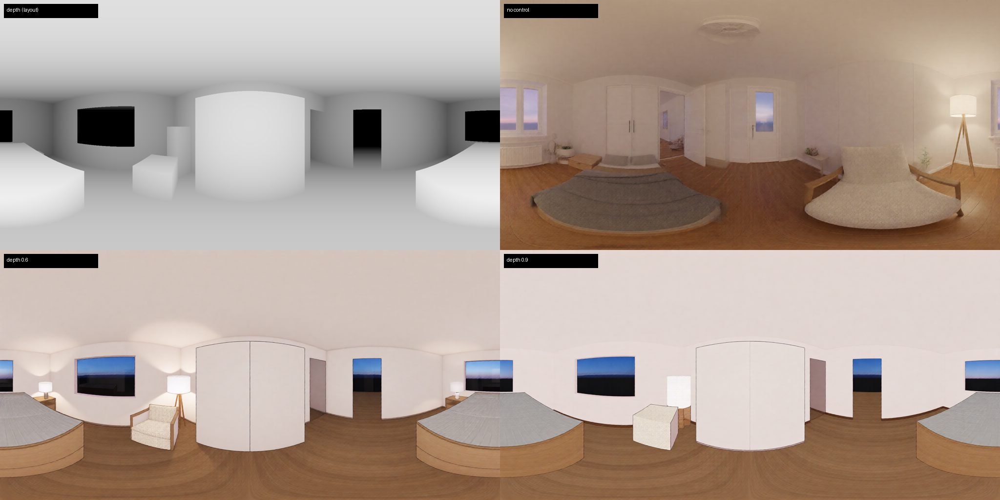

# M5 — Generative 360° room view (opt-in)

| | |
| --- | --- |
| Status | Approved (2026-10-18) |
| Date | 2026-10-18 |
| Owner | Dante |
| Decisions | [ADR-0010](../docs/adr/0010-layout-conditioned-360-panorama.md) |

## 1. Why

**Orbiting today shows the 3D model, not the photoreal room.** A render (AC-46) is one fixed eye-level frame; turning the camera drops back to the low-poly studio. Dante asked (2026-10-18): "360도 회전할때 … 생성형으로 360도 방 구현할 수 있지 않나. 물론 항상 그렇게 하면 돈이 많이 드니까 선택적으로 토글하면". A photoreal view you can look around in, standing in the room, is the natural next step after a single render, and it is the shot people share.

**It must stay the user's room, and stay opt-in.** A free text-to-360 image is a different room. The generation has to be conditioned on this layout (walls, windows, furniture positions), and it costs one large generation per view, so it is off unless the user asks for it.

Feasibility (Comfy Cloud catalog, checked 2026-10-18 via the Comfy Cloud MCP):
- `template_qwen_Image_2512_360_lora`: Qwen-Image 2512 + `qwen-360-diffusion-2512` LoRA, 2048×1024 equirectangular, open model, no paid API nodes.
- `Qwen-Image-2512-Fun-Controlnet-Union-2602` (ControlNet for the same base model, depth among its modes) and `qwen_image_depth_diffsynth_controlnet`.
- `3d_moge_panorama_to_mesh`: equirectangular panorama → textured GLB (MoGe, already used by AC-49 3D photos).
- **Proven by the spike (§7):** the 360 LoRA and depth ControlNet together keep a seamless projection and the layout.

## 2. Goals and non-goals

Goals
- From a room in the studio, "360° view" generates a photoreal equirectangular panorama from a standing point in that room, conditioned on a depth panorama of the current layout.
- The panorama opens in a look-around viewer (drag to look, no walking).
- Off by default; each generation is a deliberate click with its expected time shown; it runs as a normal job card (M3) and is available to agents as an MCP tool (M4).

Non-goals (M5)
- Walking through the panorama (option: MoGe panorama → mesh, as a follow-up once the viewer exists; see open question 3).
- Video/novel-view orbit models (NVS, Wan/Seedance camera moves): paid or not layout-conditioned; revisit if the spike fails.
- Automatic regeneration when furniture moves (stale panoramas are labelled instead).

## 3. Scenarios

1. **Look around the reading corner.** Dante focuses Bedroom and clicks "360° view". A job card "360° view · Bedroom" appears (expected ~60 s). When done, a full-window viewer opens at the room's standing point; dragging turns the view; the armchair and lamp are where the layout has them. "Close" returns to the studio.
2. **Stale view.** After moving the armchair, the Bedroom's 360° job card shows "Layout changed since this view" and a "Regenerate" button. Opening the old view still works.
3. **Agent.** "Show me the bedroom in 360" → the agent calls `view_360({ room: "bedroom" })`, gets the panorama image and its path.

## 4. Screens and states

- Studio bottom bar, next to "Render this view": **"360° view"**. Disabled with tooltip "Focus a room first" when no room is focused.
- Job card kind `pano360`: "360° view · <room>", steps uploading → queued → generating → downloading → done, actions **"Open"**, **"Regenerate"**; failure shows the server message and **"Retry"** (M3 rules).
- Viewer: a full-window dialog named **"360° view"**, the panorama on the inside of a sphere. Dragging across the viewer's full width turns 180° (yaw unlimited, wraps), full height tilts 90° (pitch clamped ±80°); wheel down widens the field of view, up narrows it (clamped 40–100°, starts at 75°). **"Close"** and Esc close it. Stale views show "Layout changed since this view" in the viewer and on the job card.
- The viewer opens by itself when a `pano360` job finishes.

## 5. Behaviour rules

- Standing point: the room polygon's centroid; if it lies within any item's footprint (half the larger of width/depth around the item), move it to the nearest point on a 10 cm grid inside the room that is clear of every footprint. Eye height 160 cm.
- Panorama axes: column 0 is yaw −180°, the centre column yaw 0 = +Z (ADR-0002 front), yaw +90 = +X; row 0 is pitch +90°. Direction for (yaw, pitch) = (sin yaw · cos pitch, sin pitch, cos yaw · cos pitch).
- The editor renders a 6-face depth cube at the standing point and converts it to a 2048×1024 equirectangular depth PNG: grey = 1 − (distance − 40 cm) / 560 cm, clamped; openings (windows, doors) read as far. Linear to 8 m (the first try) left a 5 m room almost uniformly light.
- Control strength 0.6 by default (spike: 0.9 turns soft furniture into boxes).
- Prompt = "equirectangular 360 image, " + the room name + the scene preset wording (as `render_room`), or the caller's prompt (which must then start with that prefix; the editor adds it if missing).
- One `pano360` job per room at a time; counts toward `MAX_CONCURRENT_JOBS`.
- A panorama remembers the layout revision it was made from; any later change to items in that room marks it stale.
- Panoramas are never regenerated automatically. Saving them in the layout file is a follow-up (M5 keeps them with the session's jobs).

## 6. Contract and data changes

- `JobKind` gains `pano360`; `DEFAULT_EXPECTED_SECONDS.pano360 = 60` (adjusted after the spike).
- Editor API (`spec/contracts/editor-api.ts`): `depthPanorama(zoneId)` → `{ image (PNG data URL), width, height, standingPoint, eyeHeightCm }`; `view360({ zoneId?, prompt? })` (focused room when no zoneId; `no-room` when neither); `open360(jobId)`; `close360()`; `state().viewer360 = { jobId, zoneId, yawDegrees, pitchDegrees, fovDegrees, stale } | null`.
- MCP: `view_360({ room, prompt?, preset? })` → waits; `{ jobId, path }` plus image content. `spec/contracts/mcp-tools.json` gains it.

## 7. ComfyUI workflows

- New `workflows/cloud/pano360-from-depth.json`: Qwen-Image 2512 + 360 LoRA + Lightning 4-step LoRA + Fun ControlNet Union 2602 (strength 0.6) on the depth panorama. Same tags as `render-from-depth` (`roomfit:depth`, `roomfit:positive`, `roomfit:negative`, `roomfit:seed`, `roomfit:save` with prefix `roomfit/pano360`), so the existing render prompt builder fills it. Linted against the Cloud catalog snapshot, which now pins these 12 core nodes.
- **Spike before approval** (approved and run 2026-10-18, see below): one depth panorama of the demo bedroom → (a) the template alone, (b) with depth ControlNet at strength 0.6 and 0.9. Pass if (b) keeps a seamless left/right edge and the armchair/lamp/bed land within ~15° of yaw of their layout positions. Record job ids, times and images here.

### Spike result (2026-10-18) — PASS

Depth panorama of the demo bedroom ray-cast from the layout (`demo/m5-spike/depth-panorama.py`, standing point (−450, −180), eye 160 cm); same prompt, seed 42, 2048×1024, Lightning 4 steps; ~3 Cloud generations.

| Run | Cloud job | Layout kept | Seam | Verdict |
| --- | --- | --- | --- | --- |
| no control | `d4f9a312` | no (bed/chair elsewhere) | 2.9 | photoreal, wrong room |
| depth 0.6 | `d884a841` | yes: bed wraps the seam, armchair + lamp, wardrobe ahead, 2 windows, door — all within a few degrees | 2.8 | **chosen** |
| depth 0.9 | `4f09e5e4` | yes | 2.8 | armchair becomes a box |

Seam = mean |column 0 − column 2047| in RGB, against 3.3 between two ordinary adjacent columns: the wrap is invisible.

## 8. Acceptance criteria

| AC | Status | Criterion |
| --- | --- | --- |
| AC-63 | active | `depthPanorama(zone)` returns a 2048×1024 equirectangular depth image whose nearest-wall columns line up with the room polygon's directions from the standing point (yaw error ≤ 2°) |
| AC-64 | active | "360° view" is disabled with no focused room; with one, it queues `pano360-from-depth` with the depth panorama and the prompt, and shows a `pano360` job card |
| AC-65 | active | The viewer opens the result on a sphere: drag changes yaw/pitch (pitch clamped ±80°), wheel changes FOV within 40–100°, Close/Esc closes it |
| AC-66 | active | Moving an item in the room marks that room's panorama stale; "Regenerate" queues a new job; nothing regenerates automatically |
| AC-67 | active | `view_360` MCP tool returns PNG image content and a saved path; listed in `mcp-tools.json` |
| AC-68 | active | `pano360-from-depth.json` lints against the Cloud catalog snapshot |
| AC-69 | manual | Recording on real Comfy Cloud: the demo bedroom as a 360° view, looking around past the reading corner |

## 9. Test plan

| AC | Level |
| --- | --- |
| AC-63 | e2e: read the depth PNG back, find the nearest-depth columns per wall, compare to computed yaw |
| AC-64, AC-65, AC-66 | e2e with the fake ComfyUI (returns a fixture equirectangular PNG) |
| AC-67 | e2e via the MCP SDK client (as AC-59) |
| AC-68 | vitest (as AC-54) |
| AC-69 | manual recording |

## 10. Risks and open questions

Risks
- The 360 LoRA may lose the seam or ignore depth under ControlNet → spike gates the spec; fallback: generate 4 perspective renders at 90° with the existing `render-from-depth` and stitch (cheaper per image, visible seams).
- Cost: one 2048×1024 Qwen 20B generation per view; opt-in button and stale labels avoid surprise spend.
- Equirectangular depth from a cube can show seams at face borders → AC-63 measures yaw alignment.

Open questions (recommended answers in bold)
Settled 2026-10-18 on the recommended answers (Dante: "Approve the open questions on the recommended answers if it passes"):
1. Standing point: room centroid, nudged off furniture.
2. Resolution: 2048×1024.
3. Walkable mesh (MoGe panorama → mesh): follow-up after the viewer ships.
4. Spike credits: approved and spent (3 generations).

## Change log

- 2026-10-18 Draft, from Dante's request for an opt-in generative 360° room view; feasibility checked against the Comfy Cloud catalog.
- 2026-10-18 Spike passed (depth 0.6); Approved with the recommended answers. ADR-0010.
- 2026-10-18 Spec session: contracts, Cloud catalog nodes, workflow, panorama fixture, fake ComfyUI panoramas, tests for AC-63~68; ACs active. Persisting panoramas in the layout file moved to a follow-up.
